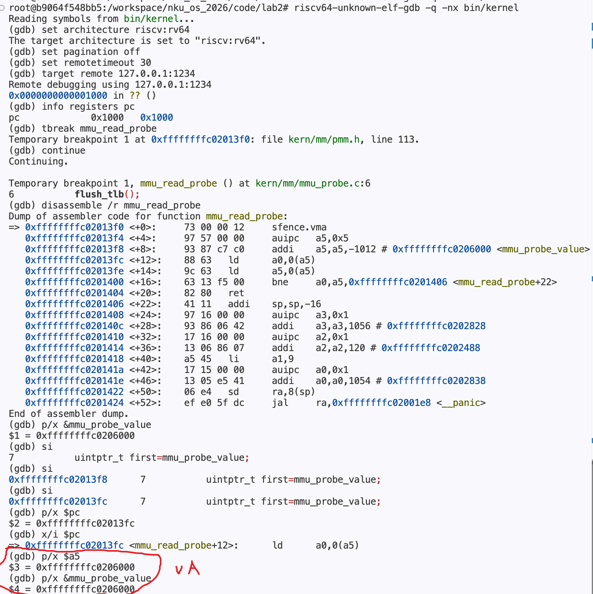
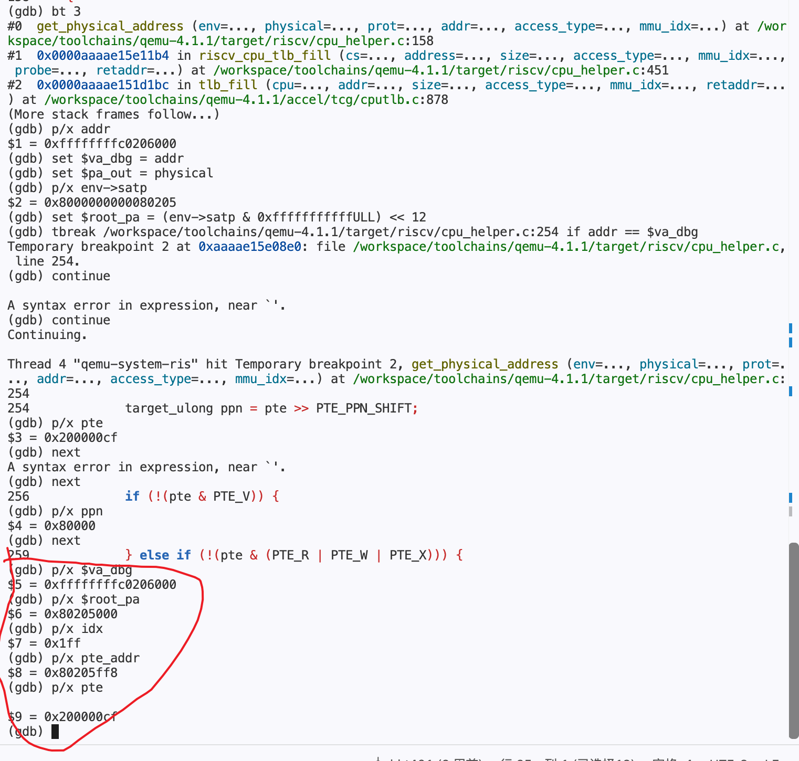
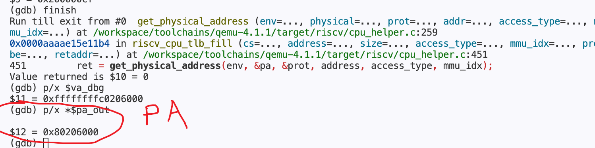
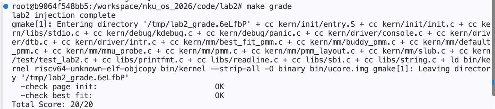

# Lab 2 答辩补充

## 一、GDB 观察虚拟地址到物理地址的转换

本次跟踪内核的一条真实 load，重点观察 **数据虚拟地址 VA `0xffffffffc0206000` 怎样被翻译成物理地址 PA `0x80206000`**。

在终端 C 中停在 `mmu_read_probe`，反汇编并执行三次 `si`，到达 `ld a0,0(a5)` 之前。`p/x $pc` 显示指令地址 `0xffffffffc02013fc`，而 `p/x $a5` 与 `p/x &mmu_probe_value` 均为 **`0xffffffffc0206000`**：a5 保存的是本条 load 要读取的数据 VA，不是当前 PC。

执行该 load 后，终端 B 的 host GDB 命中 QEMU 4.1.1 的 `get_physical_address`；调用栈显示其调用者为 `riscv_cpu_tlb_fill`。读取 `satp=0x8000000000080205` 得到根页表 PA `0x80205000`，再停到 PTE 读取之后，执行 `next` 计算 PPN，并观察有效位与叶子判断分支。截图中根索引为 `0x1ff`（511），PTE 地址为 `0x80205ff8`，实际读出的 `PTE=0x200000cf`，PPN 为 `0x80000`。

随后执行 `finish`，让翻译函数返回到 `riscv_cpu_tlb_fill`。`$va_dbg` 保存输入 VA，`$pa_out` 保存输出参数指针；`p/x *$pa_out` 读出的实际结果为 **`0x80206000`**，完成本次 VA→PA 观察。

本次根层项是合法的 1 GiB 叶子，没有走满三级页表；目标对象按 4KiB 对齐，页内偏移为 0，因此返回的物理页基址也是目标数据的 PA。

## 二、make grade 得分与 Makefile 修改说明

采用 `lab2_new` 的评分测试，终端显示测试注入完成、Page Init 与 Best-Fit 两项均为 `OK`，总分 **20/20**，两项各 10 分。

原 `grade` 入口直接运行 `tools/grade.sh`，漏掉新框架要求的测试注入。内核即使完成自身检查，也不会输出评分所需的 `[Test 1] Page Init: PASS` 和 `[Test 2] Best-Fit: PASS`，因此被判为 0/20。

修改后的 Makefile 先用 `mktemp` 创建独立临时目录，复制源码并排除旧构建产物，再执行 `tools/inject.py`。注入器把测试源码加入构建，并在 `pmm_init()` 末尾插入 `test_page_init()`、`test_best_fit()` 调用；随后在副本中运行原评分脚本，因而能够取得实际测试结果。退出时由 `trap` 清理临时目录，原内核与调试现场不被覆盖；分配算法和评分测试断言均未修改。
