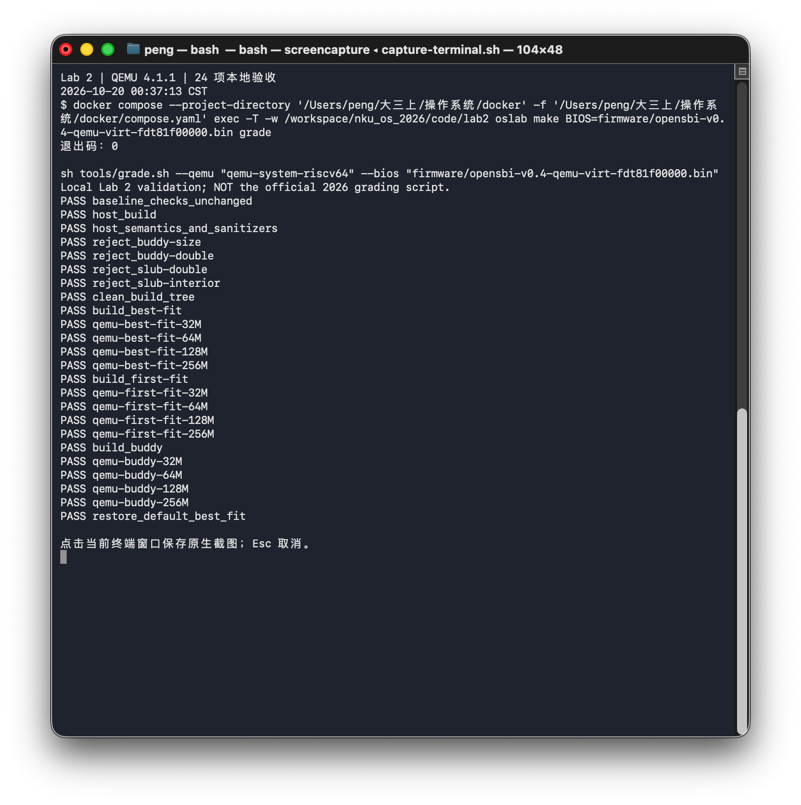
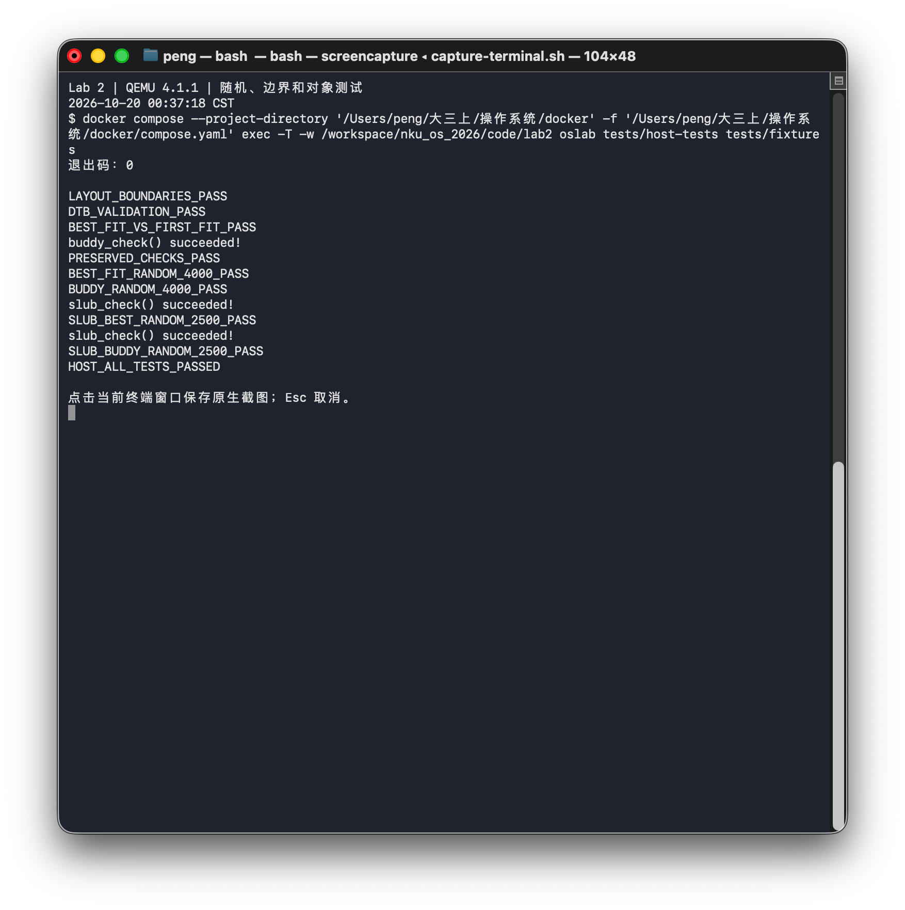
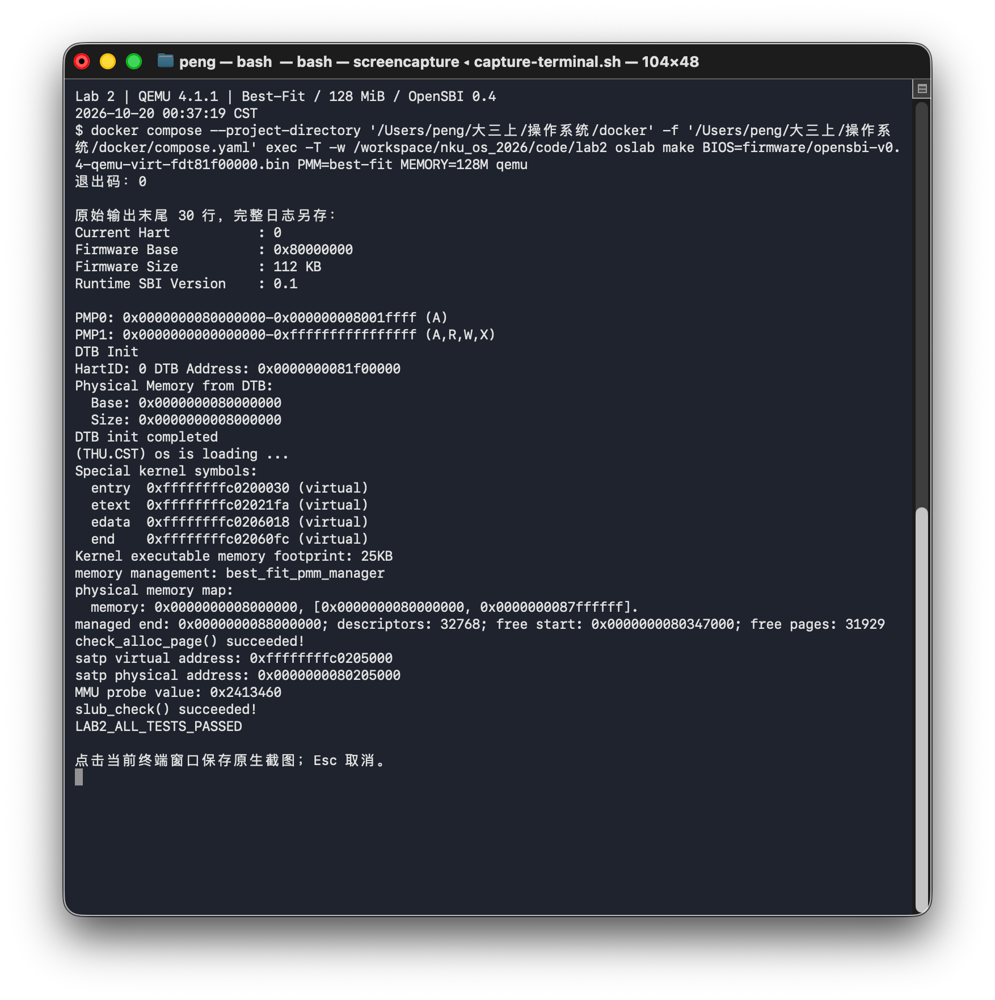
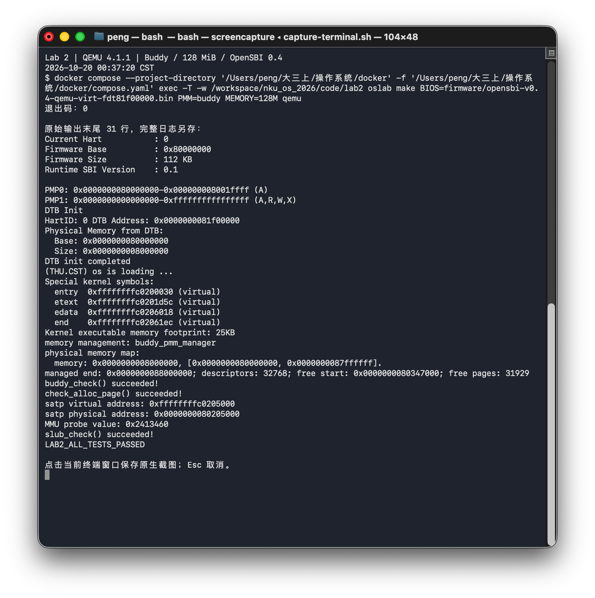
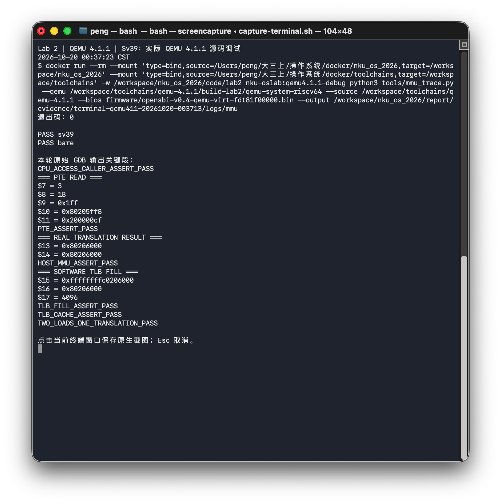
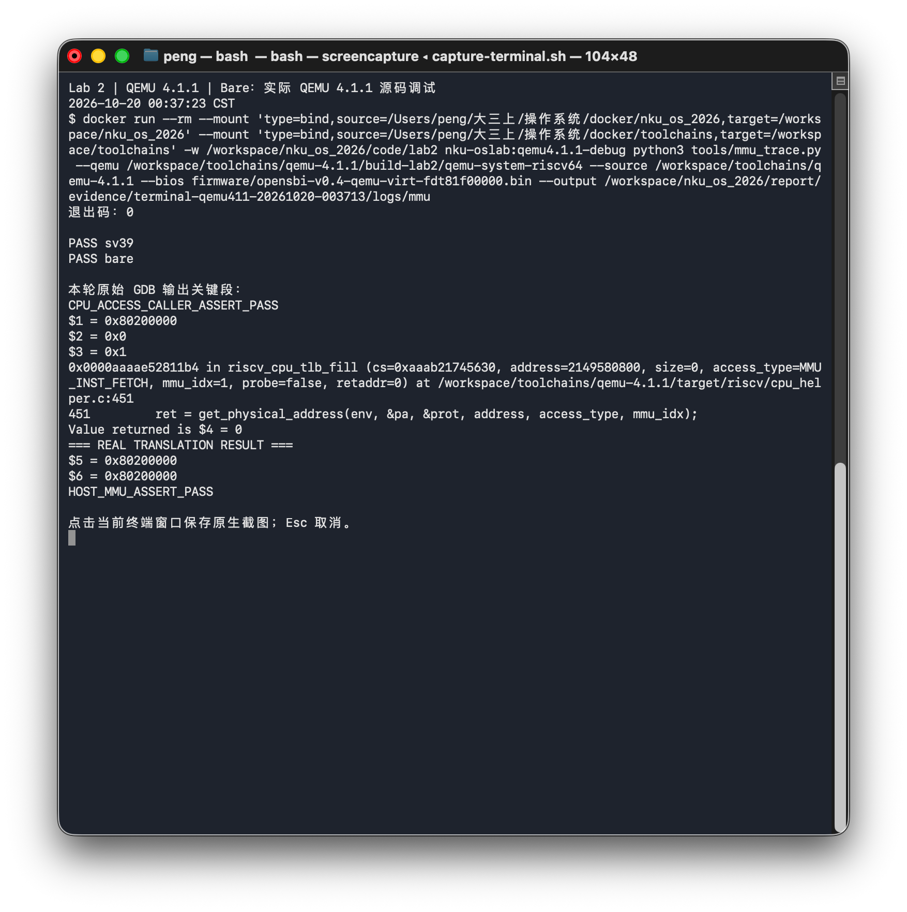

# Lab 2 实验报告：物理内存管理与 MMU/TLB 调试

## 一、实验信息与资料来源

| 项目 | 内容 |
|---|---|
| 小组成员 | 黄浩天（2413421）、林涛（2413456）、彭亚滨（2413460） |
| 小组分工 | 黄浩天、林涛、彭亚滨按下表承担模块主责，使用 AI 辅助 |
| 本次报告与截图日期 | 2026-10-20 |
| 代码入口 | [code/lab2](../code/lab2/)，默认使用 Best-Fit |
| 框架来源 | 本地旧版 RISC-V uCore Lab 2 适配；来源与检查函数副本保存在 [provenance](../code/lab2/provenance/) |

本实验完成设备树物理内存探测、页描述符初始化、First-Fit 分析、Best-Fit、Buddy，以及选做的简化 SLUB，并在 QEMU 4.1.1 中观察地址翻译过程。新版指导书将 SLUB 列为选做 Challenge；完成实现不等于已经取得助教加分。

本轮编译、验收和源码调试由 AI 工具实际执行；用户于 2026-10-20 00:37 在原生终端运行采集脚本复跑并生成七张窗口截图，图片与日志已逐项核对。该记录不代表三位成员均已独立复跑或完成分工审核。提示词按实验要求整理，见 [prompt.md](prompt.md) 和附录，不作为历史逐字对话。教师报告模板正文和当前官方注入评分包尚未取得，本文依据已取得的 HTML 要求组织；本地验收结果不等同于官方评分。

### 1.1 小组分工

| 成员 | 主责模块 | 报告章节 | 主要交付与证据 | 交叉复核 |
|---|---|---|---|---|
| 黄浩天 | DTB 解析、`pmm_layout`、`page_init`、Best-Fit | 第 4 节、5.2、10.3 中 Best-Fit 部分 | `dtb.c`、`pmm_layout.c`、`pmm.c` 的 `page_init`、`best_fit_pmm.c`；坏 DTB/布局边界、12/5/9 反例、Best-Fit 32/64/128/256 MiB 日志 | 复核林涛的 Buddy 合并/负例；复核 SLUB 页归还接口 |
| 林涛 | First-Fit 分析、Buddy 实现与独立测试 | 5.1、第 6 节、10.2 中 Buddy 随机/负例、10.3 中 Buddy 部分 | `buddy_pmm.c/h`、Buddy 独立模型测试；3/5 页舍入、509 页非对齐、4000 次随机、错误长度/双重释放负例 | 复核黄浩天的 DTB 边界和 Best-Fit 选择；复核 SLUB 对象测试 |
| 彭亚滨 | 简化 SLUB、QEMU 4.1.1 MMU/TLB 调试、统稿与证据清单 | 第 7、8、10.4、10.5、附录统稿 | `slub.c/h`、`mmu_probe.c`、`mmu_trace.py`、manifest、图 6/7；SLUB 两种底层测试 | 复核 Best-Fit 计数守恒；复核 Buddy 接入；维护固件与证据，复跑由成员共同承担 |

以上为小组确认的模块分工与交叉复核安排；各成员独立复跑及交叉复核的完成情况以实际记录为准。

## 二、实验环境与复现方法

### 2.1 QEMU 4.1.1 与 OpenSBI 0.4

宿主机为 macOS Apple Silicon，内核在 Docker 的 Linux ARM64 环境中交叉编译。普通运行使用 `docker/compose.yaml` 的 `oslab` 服务；源码调试使用独立带符号的同版 QEMU 4.1.1。两者均使用项目提供的 OpenSBI 0.4 固件配置。

| 工具或配置 | 本次实际使用 |
|---|---|
| 项目服务 / 镜像 | `oslab` / `nku-oslab:ubuntu22.04-arm64` |
| 调试环境 | `nku-oslab:qemu4.1.1-debug`，基于项目镜像增加开发依赖 |
| Linux | `6.12.76-linuxkit`，aarch64，glibc 2.35 |
| 交叉编译器 / Make / GDB | GCC 10.2.0 / 4.3 / 12.1 |
| 普通运行及源码调试 QEMU | **4.1.1**，工具会核对真实版本 |
| 固件 | QEMU 4.1.1 随附 OpenSBI **0.4** 源码构建 |
| BIOS 输入 | `firmware/opensbi-v0.4-qemu-virt-fdt81f00000.bin` |
| DTB 搬移地址 / 内核入口 | `0x81f00000` / `0x80200000` |
| 默认 RAM / PMM | `128M` / `best-fit` |

版本已核对为 QEMU 4.1.1，固件来源、许可证与重建方法见 [firmware/README.md](../code/lab2/firmware/README.md)。本轮提供的固件 SHA-256 为 `2737e0faff241cec624f24c806f72e124e7653b8c55a76a8f3321f91010e97f8`。固件横幅中的日期是构建时间，验证日期以本轮 CST 执行记录为准。

### 2.2 32 MiB 启动超时的定位与修正

原默认 OpenSBI 的 qemu/virt 配置把 DTB 固定搬到 `0x82200000`，而 32 MiB RAM 的范围为 `[0x80000000,0x82000000)`，目标地址在 RAM 之外。本轮先保留原配置复跑，仍得到 21/24；随后用未修改的同版 OpenSBI 源码，将构建参数 `FW_JUMP_FDT_ADDR` 改为 `0x81f00000`，在 QEMU 4.1.1 下重新执行原有全部用例，结果为 24/24。

逻辑配置改动是 DTB 搬移地址；构建时另外使用裸机代码所需的禁用 builtin/循环转库调用选项，解决 GCC 10 链接外部 memset 的兼容问题。没有修改内核分配算法、原始检查函数或测试预期。对归档内 OpenSBI 源码及两个 MMU 关键文件的 146 项比对没有差异，比对记录保留于本地。

该固件配置覆盖本地 32 MiB 及以上的矩阵，不承诺更小 RAM 的启动兼容性。Makefile 已将此固件列为默认 BIOS；`make BIOS=default grade` 可重现安装时原默认固件的 32 MiB 限制。

### 2.3 编译、验收与启动

宿主机 `docker/` 目录执行：

```bash
docker compose exec -T -w /workspace/nku_os_2026/code/lab2 oslab make grade
docker compose exec -T -w /workspace/nku_os_2026/code/lab2 oslab make PMM=best-fit MEMORY=128M qemu
docker compose exec -T -w /workspace/nku_os_2026/code/lab2 oslab make PMM=buddy MEMORY=128M qemu
```

`make grade` 记录实际 QEMU 版本和固件摘要，版本不是 4.1.1 时停止。默认 `SELFTEST=1`，断言完成后输出 `LAB2_ALL_TESTS_PASSED` 并经 SBI 关机；`SELFTEST=0` 用于保留现场。复跑会刷新实验内 evidence，应先保存需要保留的旧记录。

在独立 Ubuntu 22.04 环境中复现，可安装构建依赖并使用本实验脚本构建固定版本 QEMU：

```bash
sudo apt-get update
sudo apt-get install -y build-essential gcc-riscv64-unknown-elf \
  binutils-riscv64-unknown-elf gdb gdb-multiarch python3 curl xz-utils \
  pkg-config libglib2.0-dev libpixman-1-dev libfdt-dev
cd code/lab2
bash tools/build_debug_qemu.sh "$PWD/qemu-source" "$PWD/qemu-build"
export PATH="$PWD/qemu-build:$PATH"
make grade
```

构建脚本从官方发行地址取得并校验 QEMU 4.1.1，项目固件已随代码提供。MMU 调试使用同版带符号二进制和对应源码：

```bash
python3 tools/mmu_trace.py \
  --qemu "$PWD/qemu-build/qemu-system-riscv64" \
  --source "$PWD/qemu-source" --output evidence/mmu-new
```

上述命令从 Lab 2 目录执行；源码调试脚本会重新构建内核并保存 GDB 命令和日志。本次提交保留七张原生终端截图；原始日志、结果 JSON 和历史对照另存于本地。

## 三、对实验整体逻辑的理解

本实验先确定“哪些物理地址可以管理”，再解决“如何组织、分配和回收页面”，最后在页分配之上支持对象分配，并从模拟器内部观察虚拟地址如何落到物理内存。

```text
OpenSBI 传递 hart ID、DTB 物理地址
  → entry.S 建立 Sv39 临时恒等映射和高地址映射
  → kern_init 清 BSS，移除临时恒等映射
  → dtb_init 获取 RAM 基址与长度
  → pmm_init → init_pmm_manager 选择分配器
  → page_init 预留固件、内核和 Page 数组
  → init_memmap 注册完整空闲页
  → alloc_pages/free_pages 分配、切分、回收与合并
  → SLUB 在物理页上组织不同尺寸的对象
  → MMU probe 与宿主 GDB 观察 QEMU 的 TLB/page walk
```

Lab 1 建立启动和输出能力，Lab 2 提供后续进程、页表和内核对象所需的物理内存基础。这里有两类不同的管理数据：`struct Page` 是内核维护的物理页描述符，PTE 是 MMU 解释的地址映射信息；修改空闲页链表不会自动建立虚拟地址映射。

## 四、物理内存探测与页描述符初始化

### 4.1 DTB 信息与地址类型

OpenSBI 通过 `a0` 交接 hart ID，通过 `a1` 交接 DTB 的物理地址。启动汇编保留这些参数，进入高地址内核后按固定映射偏移取得可访问的内核指针。FDT 使用大端整数，解析器检查 magic、总长、结构区和字符串区范围、节点深度、属性名终止符、cell 数、`reg` 长度及地址加法溢出；支持 1/2 cells 的地址和长度。

当前实现适配 QEMU virt 的单个 DRAM bank，要求基址为 `0x80000000`，并不提供完整的多 bank、`reserved-memory` 或跨平台资源枚举。解析完成后只保留 RAM 基址和长度，不再依赖原 DTB blob。信息无效时终止初始化，不回退为硬编码 RAM 大小。

需要区分四种量：虚拟地址用于内核访存；物理地址用于描述 RAM 范围；PFN 是物理地址除以页大小；`Page *` 指向描述符数组中的元素。`nbase=0x80000000/4096` 是起始 PFN，`npage=maxpa/4096` 是管理上界的绝对 PFN，所以描述符数量为 `npage-nbase`，不能直接把 `npage` 当作 RAM 页数。

### 4.2 page_init 的实现

`page_init(void)` 设置 `va_pa_offset`，读取 `get_memory_base()/get_memory_size()`，再调用独立纯函数 `pmm_compute_layout` 计算布局。管理终点为 RAM 终点与框架上界的较小值，并向下按页对齐；描述符起点为内核 `end` 对应物理地址向上按页对齐；描述符之后的空闲起点再次向上对齐。

```text
maxpa = ROUNDDOWN(min(base + size, PHYSICAL_MEMORY_END), PGSIZE)
descriptors_count = (maxpa - base) / PGSIZE
descriptors_pa = ROUNDUP(kernel_end_pa, PGSIZE)
free_begin = ROUNDUP(descriptors_pa + descriptors_count * sizeof(struct Page), PGSIZE)
free_pages = (maxpa - free_begin) / PGSIZE
```

实现先检查加法、乘法、内核结束地址和描述符空间；上式只描述校验成功时的布局关系。描述符无处存放时返回错误；描述符可以存放但没有完整空闲页时，得到零长空闲区，不调用 `init_memmap()`。

所有描述符先清状态并标为 reserved，再将真正空闲的完整页面交给当前管理器。这样 OpenSBI、内核镜像、启动栈、启动页表和描述符数组都不会进入分配器。当前框架上界为 `0x88000000`：128 MiB 启动时有 32768 个描述符，空闲起点为 `0x80347000`，初始空闲页数为 31929；256 MiB 启动仍只管理前 128 MiB，但 DTB 如实输出 256 MiB。

### 4.3 如何在不知道硬件内存范围时获得可用内存

应优先使用固件或平台交接的信息，例如 RISC-V DTB、UEFI 内存映射、x86 E820，以及平台约定的 ACPI/板级信息。解析后还要区分 RAM、设备 MMIO、固件保留和不可用区域，扣除占用空间并按页对齐。仅凭“写一个地址再读回”探测可能破坏设备寄存器或固件数据，也不能可靠区分所有内存类型。本实验采用 DTB，与 QEMU virt/OpenSBI 的交接方式一致。

## 五、First-Fit 与 Best-Fit

### 5.1 First-Fit 的四个核心函数

`default_init` 建立空闲链表头并将空闲页计数清零。`default_init_memmap` 接收可用页区间，清除保留状态，将区间长度记在块头的 `property` 中，再按地址加入空闲链表。链表描述的是连续空闲块，只有块头设置 `PG_property`。

`default_alloc_pages(n)` 从链表起点查找第一个长度不少于 n 的块。正好匹配时移除整块；较大时分出前 n 页，把余下部分作为新空闲块留在链表中，并减少 `nr_free`。`default_free_pages` 恢复页面状态，按地址插入，再判断前块的末尾是否等于本块起点、本块末尾是否等于后块起点，分别合并相邻块并恢复计数。

`PG_reserved` 表示保留页，不能等同于普通已分配页；`PG_property` 只表示空闲块头。普通空闲块内部页与已分配页都可能不带该标志，因此不能只凭一个标志判断所有权。

First-Fit 可以改进：next-fit 避免每次从头扫描；按大小分桶或建立索引可减少查找；及时双向合并可减少相邻空闲块的分裂状态。不过 next-fit 不保证碎片更少，索引也增加维护成本，需要结合负载测量。

### 5.2 Best-Fit 的选择、切分与合并

Best-Fit 使用模块私有 `best_fit_area`，避免与 First-Fit 的全局状态重名。链表按地址排序，分配时扫描全部候选，取长度最小且足够的块；同长度时选择先遇到的低地址块。切分后余块保留在原位置，释放时按地址插入并与前后邻块合并。每次操作都应保持“空闲总页数等于链表中所有块长度之和”。

例如空闲块依次为 12、5、9 页，申请 4 页时，First-Fit 使用 12 页块，Best-Fit 使用 5 页块。该例可以直接区分两种算法的行为。默认 `init_pmm_manager()` 接入 `best_fit_pmm_manager`，不是只编译 Best-Fit 文件却继续运行 First-Fit。

原始 `basic_check()` 和 `best_fit_check()` 按本地基线逐字保留，并由完整性比较及实际执行验证。新增任务标记保留 `lab2` 并使用学号 `2413460`，源码检查未发现待填写的 `YOUR CODE`。

线性 Best-Fit 的分配查找为 O(k)，地址有序释放插入也为 O(k)，k 为空闲块数。可增加按大小组织的树或分桶，同时保留地址索引支持合并；代价是两个索引的一致性维护。Best-Fit 仍有外部碎片，也可能留下大量过小余块，并不保证在所有负载下优于 First-Fit。

## 六、Buddy System 设计与测试

### 6.1 设计

每一阶维护大小为 `2^order` 页的空闲块。初始化可用区时，根据物理 PFN 对齐和剩余长度拆分，因此能够处理起点未按大块对齐、长度不是 2 的幂的区间。分配将请求向上取整到某阶，若该阶无块，就从更高阶取块并逐阶拆分。

释放头记录原请求长度，回收必须与原请求一致。伙伴 PFN 由 `pfn XOR (1 << order)` 得到，只有伙伴位于管理区、同阶且确为空闲块头时才递归合并，不能把所有地址相邻块都视为伙伴。`MAX_ORDER=15`，超过支持阶数的请求返回 NULL。

申请 3 页实际占 4 页，申请 5 页占 8 页，空闲计数按实际占用扣减。这种幂次结构简化了拆分、配对和合并，但产生内部碎片。当前接口要求按原请求整体释放，不支持任意拆分已分配块做部分释放。

### 6.2 两份提示词与测试有效性

实现与测试分别使用独立整理的提示词，完整内容见附录及 `prompt.md` 第 3、4 节。实现规格先限定块大小、PFN 对齐、伙伴条件和计数；测试规格从外部可观察结果判断正确性。

测试覆盖 3/5 页舍入、对齐、拆分、不同释放顺序、递归合并、非对齐的 509 页区间、保留页边界、超阶失败、错误长度和双重释放。4000 次确定种子的随机操作使用独立占用图：成功结果必须位于可用区、无重叠且计数守恒；失败时还检查是否实际上存在合法的对齐空闲块，避免“总返回 NULL”也通过测试。全部回收后计数恢复。真实内核启动验证该模块已接入 `pmm_manager`。

## 七、选做 Challenge：简化 SLUB

底层通过 PMM 分配物理页，上层用 16、32、64、128、256、512、1024、2048 字节尺寸类组织对象。每个 slab 页保存类别、容量、已用数和位图，对象区域位于页头之后并按 16 字节对齐；满页后申请新页。超过尺寸类的对象回退为多页分配，保存原请求页数以兼容 Buddy 的舍入规则。空 slab 立即归还底层页。

`slub_alloc(0)` 和长度溢出返回 NULL，`slub_free(NULL)` 无操作；错位内部指针和同一 slab 内重复释放由断言拒绝。接口要求指针来自本分配器，不负责验证任意不可信地址。单核通过关中断保护元数据，未实现 Linux SLUB 的 per-CPU cache、NUMA、批量缓存或多核锁。

实现与测试的两份提示词见附录及 `prompt.md` 第 5、6 节。测试包含尺寸类边界、16 字节对齐、写入读回、300 个小对象跨页扩展、释放槽复用、多页大对象、空页归还、零长/溢出以及非法释放。Best-Fit 与 Buddy 底层各运行 2500 次随机对象操作，检查存活对象无重叠、字节模式不变且释放后页数恢复。sanitizer 检查宿主代码中的越界和未定义行为；自定义对象的槽边界还依靠占用模型与数据检查，有限测试不构成全部输入的正确性证明。

## 八、QEMU 4.1.1 的 MMU/TLB 源码调试

### 8.1 实际 CPU 访问与调用路径

guest GDB 面向 RISC-V 内核，host GDB 面向 Linux ARM64 的 QEMU 进程。本轮由 host GDB 启动带符号 QEMU 4.1.1，针对已知 probe 地址设置条件断点。内核先执行 sfence.vma，再连续读取同一个 volatile 数据对象，读取结果通过断言核对。

QEMU 4.1.1 的 get_physical_address 没有新版的 is_debug 参数。本轮限定访问地址和类型，并断言其直接调用者为 riscv_cpu_tlb_fill，记录 `CPU_ACCESS_CALLER_ASSERT_PASS`；没有通过 guest GDB 读取目标内存来代替 CPU 访存。真实调用链为：

```text
TCG code_gen_buffer
 → helper_le_ldq_mmu → load_helper
 → tlb_fill → riscv_cpu_tlb_fill → get_physical_address
 → 读取并检查 PTE → tlb_set_page
```

对应源码为 [load_helper](https://github.com/qemu/qemu/blob/v4.1.1/accel/tcg/cputlb.c#L1248)、[TLB miss 分支](https://github.com/qemu/qemu/blob/v4.1.1/accel/tcg/cputlb.c#L1271)、[地址翻译](https://github.com/qemu/qemu/blob/v4.1.1/target/riscv/cpu_helper.c#L155)、[PTE 读取](https://github.com/qemu/qemu/blob/v4.1.1/target/riscv/cpu_helper.c#L252) 和 [riscv_cpu_tlb_fill](https://github.com/qemu/qemu/blob/v4.1.1/target/riscv/cpu_helper.c#L435)，行号对应实际使用的 4.1.1。

### 8.2 页表翻译与关键分支

load_helper 先查普通软件 TLB，未命中时再检查 victim TLB；仍未命中才进入填充。get_physical_address 根据特权级和 satp 区分 Bare 与分页模式。Sv39 检查虚拟地址规范性，从根 PPN 开始按各级索引读取 PTE；本版使用 `ldq_phys` 读取 64 位页表项。

V 无效时失败；R/W/X 均为零时进入下一级；叶子项需要通过非法权限组合、U/S 权限、访问类型和大页对齐检查。必要时更新 A/D 位，再生成物理页地址。成功翻译还需通过 PMP 检查，之后填入软件 TLB。这些分支来自源码分析；本轮动态观察了成功路径，没有逐个触发全部错误路径。

| 观察项 | 本轮实测 |
|---|---|
| guest VA | `0xffffffffc0206000` |
| satp | `0x8000000000080205`，MODE=8，即 Sv39 |
| 根页表 PA / 根索引 | `0x80205000` / 511 |
| PTE 地址 / 值 | `0x80205ff8` / `0x200000cf` |
| 叶子层级 | 根层 1 GiB 叶子，未走满三级 |
| 实际输出 PA | `0x80206000` |
| 缓存结果 | 首次 miss，填充后目标页匹配；两次 load 只有一次目标翻译 |

`PTE_ASSERT_PASS`、`HOST_MMU_ASSERT_PASS`、`TLB_FILL_ASSERT_PASS`、`TLB_CACHE_ASSERT_PASS` 和 `TWO_LOADS_ONE_TRANSLATION_PASS` 均出现在本轮 Sv39 原始日志中。手算页表用于核对实际输出，不替代源码调试。图 6 展示其中的关键段。

### 8.3 Bare 对照与软件 TLB

Bare 对照选取内核第一条指令的真实取指，访问类型为 MMU_INST_FETCH，satp=0，VA 与 PA 均为 `0x80200000`。日志包含 get_page_addr_code、tlb_fill、riscv_cpu_tlb_fill 和 get_physical_address 的实际调用栈，见图 7，完整日志保留于本地。断言后脚本主动结束该次被调试进程，日志中的 killed 属于收尾。

真实硬件 TLB 缓存地址翻译与权限；QEMU 软件 TLB 还保存 guest 页到宿主 RAM 指针/加数及 I/O 属性。因此 Bare 模式没有 Sv39 页表遍历，QEMU 仍可能使用软件 TLB 完成访存。此次没有测量真实硬件 TLB 的容量、替换算法或命中率。

调试中可见，写入 satp 后仍要继续执行当前低地址指令，所以跳高地址之前需要临时恒等映射；Sv39 支持三级页表，也允许在合法大页叶子处提前结束。使用目标地址条件断点可避免被大量其他访存打断。SIGPIPE 的处理设置沿用脚本，本轮没有另行触发信号验证其影响。

## 九、AI 辅助实现中的问题与处理

已有实现记录包括硬编码 RAM、分配器全局状态重名、启动映射和宿主头文件冲突；本轮新增处理了固件边界、旧版本构建目标及调试接口差异。

| 问题 | 定位依据 | 处理与证据 |
|---|---|---|
| 硬编码 RAM 不反映 -m | page_init 未使用 DTB | 使用有界解析和独立布局函数，多 RAM 与坏输入测试覆盖 |
| Best-Fit 与 First-Fit 状态重名 | 同名外部 free_area | Best-Fit 采用模块私有状态 |
| 开启分页后低地址取指失效 | 写 satp 后的执行地址 | 保留临时恒等映射，进入高地址后移除 |
| 宿主测试误用内核 stdio/string | FILE、strchr、memset 类型错误 | 系统头优先，内核 libs 使用 -idirafter |
| 原始检查出现现有警告 | 宿主 Wall/Wextra 输出 | 仅对三类既有警告取消 Werror，不修改检查与断言 |
| 32 MiB 无输出超时 | 固件 FDT 目标 0x82200000 超出 RAM | 同版源码用构建参数改到 0x81f00000，原用例保留且复跑通过 |
| 旧固件链接时缺少 memset | GCC 将裸机循环优化为库调用 | 使用 -fno-builtin 和 -fno-tree-loop-distribute-patterns，不改固件源码 |
| QEMU 4.x 没有根目录同名 Make 目标 | 构建报 No rule to make target | 按实际构建布局编译，调试程序位于 riscv64-softmmu/，另建路径别名 |
| 旧调试脚本依赖新版参数与源码位置 | 4.1.1 无 is_debug，PTE 读取位置不同 | 按真实源码定位，验证 CPU 调用者、PTE、PA、缓存与翻译次数 |

提示词规定输入输出、状态不变量、失败语义和验证方法，Buddy/SLUB 的实现与测试分别提出要求。按要求整理的提示词不作为当时逐字对话；本次代码执行、用户复跑和截图分别记录。

## 十、QEMU 4.1.1 本轮验收与终端截图

### 10.1 固件修正前后

| QEMU | OpenSBI 配置 | 本地验收 |
|---|---|---|
| 4.1.1 | 原默认配置，DTB 0x82200000 | 21/24；32 MiB 三项超时 |
| 4.1.1 | 同版重建，DTB 0x81f00000 | **24/24**，32/64/128/256 MiB 均通过 |

本轮原默认固件的失败记录和修正后 AI 执行的验收记录分别保存在本地，结果如上表所列。用户于 00:37 使用相同 QEMU 和固件再次复跑并采集截图；以下七张截图均来自该轮实际运行。

### 10.2 完整本地验收与宿主测试

本轮 `make grade` 退出码为 0，24 项包括原始检查完整性、宿主构建与 sanitizer、四个非法释放负例、构建树清理、三种管理器构建、12 次真实启动及默认 Best-Fit 镜像恢复。24 项中包含构建和完整性检查，并不等于 24 个独立算法测试。图 1 展示该轮验收结果，完整输出与结果 JSON 保留于本地。



图 1：QEMU 4.1.1 下完整验收的真实终端输出，命令中明确使用项目固件，24 项通过。

Best-Fit/Buddy 各 4000 次随机页操作，SLUB 在两种底层各 2500 次随机对象操作，每次完整宿主测试共 13000 次随机迭代，另覆盖 DTB、布局边界和两种适配策略的选择差异。随机模型检查范围、重叠、计数和数据；有限用例不构成全部输入的正确性证明。对应输出见图 2，完整日志保留于本地。



图 2：单独运行已带 sanitizer 构建的宿主程序，出现 HOST_ALL_TESTS_PASSED，退出码为 0。非法释放负例由完整验收分别检查预期 SIGABRT，而不是把任意异常当作通过。

### 10.3 三种分配器与 RAM 矩阵

| 管理器 | 32 MiB | 64 MiB | 128 MiB | 256 MiB |
|---|---|---|---|---|
| Best-Fit | 通过 | 通过 | 通过 | 通过 |
| First-Fit | 通过 | 通过 | 通过 | 通过 |
| Buddy | 通过 | 通过 | 通过 | 通过 |

每次启动都核对 DTB 大小、管理上界、PMM 检查、probe 值、SLUB 检查和退出状态。32 MiB 新日志中 DTB 地址为 0x81f00000、管理终点为 0x82000000，确认地址修正后最小矩阵容量能够启动。



图 3：Best-Fit 的 128 MiB 实际启动，显示 DTB 地址、页布局、probe 和全部内核检查完成。



图 4：Buddy 的实际启动，buddy_check 和 SLUB 检查通过。两次启动的完整日志保留于本地。


图 5：DTB 的 Size=0x10000000 表示 256 MiB，managed end=0x88000000 反映框架只管理前 128 MiB，探测与管理范围得到区分，完整日志保留于本地。

### 10.4 同版 QEMU 源码调试截图



图 6：QEMU 4.1.1 的 CPU 调用者、PTE、实际 PA、TLB 填充与两次读取一次翻译断言。



图 7：同版 Bare 取指，satp=0，VA/PA 均为 0x80200000；两项源码调试退出码均为 0。

七张图片由用户在 macOS 原生终端执行采集脚本后，通过系统窗口截图获得；内核和 GDB 的长输出展示原始日志末尾或关键段，完整日志另存。正式图片与采集原件逐字节一致，没有绘制、拼接或改写结果。命令、时间与退出码可见截图；版本、固件和图片摘要另存于本地采集记录。

### 10.5 验证范围与历史记录

2026-10-19 的 6.2.0 辅助记录和原固件 4.1.1 失败记录保留为历史证据；本报告的本轮结论、MMU 调用链和七张正式图均对应 2026-10-20 的 QEMU 4.1.1 与本节列明的 OpenSBI 配置。框架管理上界、单 DRAM bank、单核和简化对象分配等限制保持不变。

make grade 属于本地验收，当前官方框架/注入评分及线上 CI 均未运行。

## 十一、实验知识与 OS 原理的对应

| 实验知识 | OS 原理含义 | 对应关系与本实验差异 |
|---|---|---|
| DTB 与 RAM 探测 | 硬件资源发现、可用与保留资源区分 | 为分配器提供边界；仅处理 QEMU virt 单 DRAM bank |
| Page 描述符与空闲链表 | 物理页元数据和空闲空间管理 | 用块头和链表组织空闲页，不等同于地址映射 |
| First/Best-Fit | 连续分配与外部碎片 | 一个优先低扫描位置，一个优先小余量，均可能产生外部碎片 |
| Buddy | 幂次分块与内部碎片 | PFN 配对便于拆分合并，但请求向上取整会浪费块内空间 |
| SLUB | 页上对象分配与对象缓存 | 将小对象装入页，当前为教学尺寸类实现，无 per-CPU/NUMA |
| satp、Sv39 与 PTE | 虚实地址翻译、权限和层级页表 | 本实验启动映射使用 1 GiB 大页，不是完整用户空间页表 |
| TLB 与 sfence.vma | 翻译缓存及页表变更后的同步 | 观察 QEMU 的缓存路径；单核，没有跨核 shootdown |
| SBI | 特权层之间的服务接口 | 用于输出与关机，采用 legacy SBI，而非完整现代扩展封装 |

## 十二、重要但本实验未覆盖的原理

用户进程隔离、系统调用权限检查、按需分页、缺页恢复、页面置换、写时复制（COW）、进程调度、完整同步与死锁处理、文件系统、复杂设备驱动以及多核内存一致性均未在本实验实现。物理页分配只提供这些机制的存储基础，例如缺页处理还需要异常入口、虚拟地址空间和页表更新策略；有一个可用页分配器并不意味着已经具备虚拟内存管理的全部能力。

## 十三、Spec 与 Prompt 的设计方法

依据指导书 Lab 0.5 的[提示词结构](http://oslab.mobisys.top/lab2026/_book/lab0.5/3_prompt_structure.html)，本报告附录与独立提示词文档统一使用四段式框架。`[PROMPT]` 明确任务、操作要求和输出要求；`[RELY]` 仅给出与当前任务相关且已核对的真实宏、结构与接口；`[GUARANTEE]` 列出必须实现或修改的接口；`[SPECIFICATION]` 为主要接口规定 Pre-Condition、Post-Condition，并按需补充 Case 与 Requirements。规格描述可检验的行为，不用实现步骤替代前后状态约束。思考题仅交付报告内容，不虚构 C 接口；Buddy/SLUB 的实现与独立测试各用一条提示词。

| 任务 | Spec 的约束重点 | Prompt 的组织与验证 |
|---|---|---|
| page_init 与 DTB | 地址类型、上界、对齐、保留区、无效输入和零空闲页 | 提供启动交接与框架接口，要求纯布局函数、坏输入测试和多 RAM 启动 |
| First-Fit 思考题 | 四个函数、块头状态、切分与双向合并 | 要求用具体过程解释，并讨论改进代价 |
| Best-Fit | 最小足够块、计数守恒、地址有序、保留原检查 | 要求默认接入，使用 12/5/9 页反例和独立模型验证 |
| Buddy 实现 | 阶、PFN 对齐、请求舍入、伙伴条件及释放匹配 | 从零接入 PMM，明确最大阶与内部碎片 |
| Buddy 测试 | 返回范围、无重叠、计数、合并与失败正确性 | 单独提出随机模型、非对齐区间和错误释放负例 |
| SLUB 实现 | 两层分配、尺寸类、位图、对齐、多页回退和页归还 | 明确 Best-Fit/Buddy 都可作底层 |
| SLUB 测试 | 尺寸边界、对象完整性、跨页扩展及非法释放 | 用独立数据模式、区间比较和 sanitizer 互补检查 |
| MMU/TLB 分支（QEMU 4.1.1） | 真实 CPU 访问、实际 PA、miss/填充与 Bare 对照 | 限定条件断点并排除调试器访问，保存调用栈与断言 |
| 硬件内存范围思考题 | 固件资源描述、可用/保留/MMIO 边界 | 只交付报告回答，区分平台机制和已实现接口 |
| 环境与原生终端证据 | QEMU 4.1.1、固件配置、真实命令及原生终端证据 | 保留采集接口与固件重建方法，区分完整日志和截图摘录 |

附录给出完整整理文本；独立文件 [prompt.md](prompt.md) 的任务正文与附录一致。提示词中提出的测试目标以本报告实际结果为准，不能仅凭提示词写了“检查通过”就认为测试已经执行。

## 附录 A：按实验任务整理的完整 Spec 与 Prompt

### 0. First-Fit 思考题：理解与改进

[PROMPT]

**任务**：阅读 `kern/mm/default_pmm.c`，在仓库根目录 `report/report.md` 第五节写明初始化、登记空闲区、分配、回收合并和可选改进。

**操作要求**：必须修改项目中的真实报告文件；本题只分析现有代码，不修改分配器、测试函数或函数签名。

**输出要求**：依据以下上下文、交付清单与行为规格更新报告，解释采用自己的表述，并给出能区分分配策略的具体例子。

[RELY]

工作目录为 `code/lab2/`，报告路径相对仓库根目录。以下为 `memlayout.h` 中实际字段的摘录，仅去掉注释：

```c
struct Page {
    int ref;
    uint64_t flags;
    unsigned int property;
    list_entry_t page_link;
};

typedef struct {
    list_entry_t free_list;
    unsigned int nr_free;
} free_area_t;
```

`PG_reserved` 表示保留页；`PG_property` 表示空闲块头，`property` 记录块长。链表地址有序，`nr_free` 统计空闲页。需阅读的现有接口为：

```c
static void default_init(void);
static void default_init_memmap(struct Page *base, size_t n);
static struct Page *default_alloc_pages(size_t n);
static void default_free_pages(struct Page *base, size_t n);
```

[GUARANTEE]

交付报告中的 First-Fit 函数解释、一次连续页分配/释放示例和改进分析；不要求新增或修改 C 接口，也不为思考题虚构实现函数。

[SPECIFICATION]

#### default_init / default_init_memmap 的报告说明

**Pre-Condition**：报告编写者能够读取上述真实接口及结构，已区分物理页和描述符。

**Post-Condition**：说明初始化后空链表与零计数，以及登记可用区后块头、页状态和计数之间的关系。

**Requirements**：说明 init_memmap 的输入页须为合法保留页；不能把“没有 PG_property”直接解释成“已分配”。
#### default_alloc_pages / default_free_pages 的报告说明

**Pre-Condition**：已有地址有序空闲块链表，分配请求为正整数页。

**Post-Condition**：解释首次适配、恰好匹配/切分、失败不改变状态，以及释放后与前后相邻块合并和计数恢复。

**Case 1**：给定 12、5、9 页的空闲块并申请 4 页，First-Fit 选择第一块；报告说明该例与 Best-Fit 的差异。

**Case 2**：释放后出现物理地址相邻的空闲块时，说明双向合并如何恢复连续区间。
#### First-Fit 改进分析

**Pre-Condition**：已有对线性扫描和外部碎片的解释。

**Post-Condition**：讨论 next-fit、分桶或树索引的收益与代价，区分查找效率和碎片改善，不给出未经负载验证的绝对优劣结论。

### 1. 物理内存探测与页描述符初始化

[PROMPT]

**任务**：在 `kern/driver/dtb.c` 实现内存信息解析，在 `kern/mm/pmm_layout.c` 实现安全布局计算，在 `kern/mm/pmm.c` 实现 `page_init()`；必要时只调整对应头文件、`kern/init/entry.S` 和 `kern/init/init.c` 的参数交接。

**操作要求**：必须修改项目实际文件并保持公开接口和现有启动逻辑；在 `lab2` 标记处使用学号 `2413460`，不改原始分配器检查。允许新增模块私有 static 辅助函数；纯布局函数是已公开的可测试接口，不把它改为 static。

**输出要求**：依据下列真实声明和行为规格补全模块，说明修改文件与验证方法；不引入堆、进程或多 bank 管理等无关功能。

[RELY]

OpenSBI 入口参数为 a0=hart ID、a1=DTB PA；启动映射允许内核访问交接的 DTB。下列常量和字段摘自当前工程：

```c
#define PGSIZE          4096
#define PGSHIFT         12
#define DRAM_BASE          0x80000000
#define PHYSICAL_MEMORY_END         0x88000000
#define PHYSICAL_MEMORY_OFFSET      0xFFFFFFFF40000000

struct Page {
    int ref;
    uint64_t flags;
    unsigned int property;
    list_entry_t page_link;
};

struct Page *alloc_pages(size_t n);
void free_pages(struct Page *base, size_t n);
size_t nr_free_pages(void);
extern struct Page *pages;
extern size_t npage;
extern const size_t nbase;
extern uint64_t va_pa_offset;
```

`npage` 为管理上界的绝对 PFN，描述符数量为 `npage-nbase`，`pages[PFN-nbase]` 对应该物理页。可使用 `PADDR`、`pa2page`、`ROUNDUP`、`ROUNDDOWN`、页面状态宏、`panic`、`cprintf`、链接符号 `end`，以及当前管理器的 `init_memmap`；这些依赖不属于本题要重写的接口。

当前启动固件将 DTB 搬至 0x81f00000；本地硬件启动矩阵从 32 MiB 起，纯布局函数的边界测试不依赖能否在更小 RAM 下启动固件。

[GUARANTEE]

必须实现或保持下列接口及布局结构，签名以头文件为准：

```c
int dtb_parse_memory(const void *blob, size_t limit, uintptr_t *base, uintptr_t *size);
void dtb_init(uintptr_t hartid, uintptr_t dtb_pa);
uintptr_t get_memory_base(void);
uintptr_t get_memory_size(void);

struct pmm_layout {
    uintptr_t maxpa, descriptors_pa, free_begin;
    size_t descriptors_count, free_pages;
};
int pmm_compute_layout(uintptr_t base, uintptr_t size, uintptr_t kernel_end,
                       uintptr_t limit, size_t descriptor_size, struct pmm_layout *out);

static void page_init(void);
```

辅助函数仅服务于解析、边界校验或初始化，不改变 PMM 对外接口。

[SPECIFICATION]

#### dtb_parse_memory

**Pre-Condition**：blob 非空时指向 limit 字节的可读区域；输出指针非空时指向可写的 uintptr_t。空指针、短输入和坏数据也是待拒绝的输入。

**Post-Condition**：合法输入返回 0 并输出首个内存区的基址和大小；非法输入返回 -1，不输出伪造的默认内存范围。

**Case 1**：FDT 合法时按大端整数读取 1/2 cells 的地址和长度，完成结构解析后才公布结果。

**Case 2**：magic、区域范围、属性、节点层次、字符串终止符、cells、reg 长度或地址加法不合法时拒绝；零长度内存同样拒绝。

**Requirements**：不越过调用者给定的可读边界，不使用尚未初始化的堆；该解析器不是完整的多 bank/reserved-memory 管理器。
#### dtb_init

**Pre-Condition**：入口 hartid 和 DTB 物理指针已正确传递，启动映射已建立；候选 DTB 地址必须落在本机支持的映射窗口。

**Post-Condition**：成功时保存解析出的 RAM 信息并打印真实基址和长度，供 getter 使用；非法地址或信息导致 panic。

**Requirements**：指针转换遵循当前映射；不覆盖尚未解析的交接参数，不将错误静默替换成固定 128 MiB。
#### get_memory_base

**Pre-Condition**：dtb_init 已成功完成。

**Post-Condition**：返回先前保存的 RAM 物理基址，不修改解析结果或重新分配资源。
#### get_memory_size

**Pre-Condition**：dtb_init 已成功完成。

**Post-Condition**：返回先前保存的 RAM 长度，不修改解析结果或重新分配资源。
#### pmm_compute_layout

**Pre-Condition**：输入值按 uintptr_t/size_t 表示；out 非空时指向可写结构，NULL 输出和非法参数须被拒绝。

**Post-Condition**：成功返回 0，输出互不侵占的描述符区、管理上界与完整空闲页范围；失败返回 -1，不发布部分布局。

**Case 1**：内存范围与描述符容量合法时，管理上界受 limit 限制并向下页对齐，描述符起点和空闲起点向上页对齐。

**Case 2**：信息无效、地址/长度运算溢出、内核越界或描述符放不下时失败，不产生可注册区间。

**Case 3**：描述符放得下但没有完整空闲页时仍返回合法布局，free_pages 为 0。

**Requirements**：纯计算接口，不访问真实 RAM、不修改分配器；先检查算术和空间，再进行对齐及布局发布。
#### page_init

**Pre-Condition**：内核处于高地址映射，DTB 已初始化，所选 pmm_manager 已完成 init；链接符号和描述符所在内存可写。

**Post-Condition**：设置 va_pa_offset、npage、pages；固件、内核和描述符占用页不进入空闲区，剩余完整页交给所选管理器。

**Case 1**：RAM 基址及布局合法且有空闲页时，先初始化并保留全部受管描述符，再注册可分配区。

**Case 2**：基址不适配当前启动映射，或 RAM/布局无效时 panic，不继续分配。

**Case 3**：没有完整空闲页时完成合法元数据初始化，但不调用零长度 init_memmap。

**Requirements**：区分 VA、PA、PFN 和 Page 指针；保留框架管理上界，256 MiB 探测结果不能被伪写成 128 MiB。

### 2. Best-Fit 连续物理内存分配

[PROMPT]

**任务**：补全 `kern/mm/best_fit_pmm.c` 的管理函数与注册对象，并在 `kern/mm/pmm.c` 的 `init_pmm_manager()` 中将默认管理器接为 Best-Fit；对应声明位于 `best_fit_pmm.h`。

**操作要求**：必须修改实际文件，保留原始 basic_check、best_fit_check 的全部文本与断言；不重写 First-Fit。新实现保留 lab2/2413460 标记，模块状态私有，允许新增 static 合并辅助函数。

**输出要求**：按照下列接口和规格实现模块，给出默认接入点、选择策略与改进空间；使用既有检查和独立选择反例验证。

[RELY]

以下结构和声明取自当前 `pmm.h`、`memlayout.h`，仅去注释：

```c
struct pmm_manager {
    const char *name;
    void (*init)(
        void);
    void (*init_memmap)(
        struct Page *base,
        size_t n);
    struct Page *(*alloc_pages)(
        size_t n);
    void (*free_pages)(struct Page *base, size_t n);
    size_t (*nr_free_pages)(void);
    void (*check)(void);
};

struct Page {
    int ref;
    uint64_t flags;
    unsigned int property;
    list_entry_t page_link;
};

typedef struct {
    list_entry_t free_list;
    unsigned int nr_free;
} free_area_t;

struct Page *alloc_pages(size_t n);
void free_pages(struct Page *base, size_t n);
size_t nr_free_pages(void);
extern struct Page *pages;
extern size_t npage;
extern const size_t nbase;
extern uint64_t va_pa_offset;
```

```c
#define PG_reserved                 0
#define PG_property                 1
#define SetPageReserved(page)       set_bit(PG_reserved, &((page)->flags))
#define ClearPageReserved(page)     clear_bit(PG_reserved, &((page)->flags))
#define PageReserved(page)          test_bit(PG_reserved, &((page)->flags))
#define SetPageProperty(page)       set_bit(PG_property, &((page)->flags))
#define ClearPageProperty(page)     clear_bit(PG_property, &((page)->flags))
#define PageProperty(page)          test_bit(PG_property, &((page)->flags))
#define le2page(le, member)                 \
    to_struct((le), struct Page, member)
```

可使用 `list.h` 的双向链表操作和 `set_page_ref`。PMM 包装层负责单核中断保护；管理函数不更改公开 ABI。

`default_pmm.c` 已定义自己的 free_area，不可引入同名外部定义。原始检查依赖块头 property、空闲链表和计数约定；初始可用区由 page_init 注册。

[GUARANTEE]

```c
static void best_fit_init(void);
static void best_fit_init_memmap(struct Page *base, size_t n);
static struct Page *best_fit_alloc_pages(size_t n);
static void best_fit_free_pages(struct Page *base, size_t n);
static size_t best_fit_nr_free_pages(void);
static void init_pmm_manager(void);
extern const struct pmm_manager best_fit_pmm_manager;
```

注册对象必须填齐 pmm_manager 的六个回调；check 指向保留的 best_fit_check。

[SPECIFICATION]

#### best_fit_init

**Pre-Condition**：没有尚待保留的本模块分配状态，允许初始化私有管理区。

**Post-Condition**：空闲链表为空、空闲页计数为 0，各状态属于 Best-Fit 模块自身。
#### best_fit_init_memmap

**Pre-Condition**：管理器已初始化，n>0，base 起的 n 个描述符是未登记且合法的保留页，范围不与已有可用区重叠。

**Post-Condition**：这些页成为可分配资源，块头、链表顺序与空闲计数一致，原有可用页不丢失。

**Requirements**：只将空闲块头标为 PG_property，清除可用页的保留状态并维护连续空闲区。
#### best_fit_alloc_pages

**Pre-Condition**：请求 n>0，空闲链表和计数满足不变量。

**Post-Condition**：成功返回最小足够空闲块的起始页且恰好交出 n 页；失败返回 NULL，状态保持不变。

**Case 1**：存在恰好匹配块时移出该空闲块，正确清除分配块头的空闲标记。

**Case 2**：最小足够块更大时，仅交出请求部分，余量仍可分配且链表地址顺序正确。

**Case 3**：总空闲页不足或没有足够连续块时返回 NULL；相同大小候选选择低地址块。

**Requirements**：空闲计数等于全部空闲块长度之和；不能把 First-Fit 的首个匹配块当作 Best-Fit 结果。
#### best_fit_free_pages

**Pre-Condition**：n>0，base 起的页面均属于可合法回收的已分配区间，未保留且未与现有空闲块重叠。

**Post-Condition**：回收区间重新可用，空闲计数增加 n，地址相邻的前后空闲块合并，链表与块头状态一致。

**Case 1**：与前后均不相邻时形成独立空闲块。

**Case 2**：与一侧或两侧相邻时合并对应区间，失去块头身份的描述符不再带有效空闲块头标记。

**Requirements**：参数错误可通过原有断言拒绝，不削弱既有检查来接受非法回收。
#### best_fit_nr_free_pages

**Pre-Condition**：模块状态有效。

**Post-Condition**：返回当前可分配物理页总数，不改变状态。
#### init_pmm_manager / best_fit_pmm_manager

**Pre-Condition**：构建参数可选择 best-fit、first-fit 或 buddy，对应注册对象存在。

**Post-Condition**：默认配置实际使用 Best-Fit 并执行其初始化和原始检查；显式选择其他分配器仍有效。

**Requirements**：保留已有可切换入口；报告讨论线性扫描、分桶/树索引与碎片的权衡。

### 3. Buddy System：实现提示词

[PROMPT]

**任务**：从零组织 `kern/mm/buddy_pmm.c`、`buddy_pmm.h` 的 Buddy 管理模块，接入 `pmm.c` 与 Makefile 的 PMM=buddy 选择；已存在的实现按本规格补全，不用独立用户程序替代内核接入。

**操作要求**：必须修改实际工程文件，保留默认 Best-Fit 和原始 First/Best-Fit 检查；只修改 Buddy 及其接入位置。私有辅助函数和状态使用 static；不改变 Page 布局和 PMM 公开签名。

**输出要求**：依据四段式内容交付可编译运行的管理器和基本自检；完整独立测试由下一条提示词单独完成。

[RELY]

以下结构和声明取自当前 `pmm.h`、`memlayout.h`，仅去注释：

```c
struct pmm_manager {
    const char *name;
    void (*init)(
        void);
    void (*init_memmap)(
        struct Page *base,
        size_t n);
    struct Page *(*alloc_pages)(
        size_t n);
    void (*free_pages)(struct Page *base, size_t n);
    size_t (*nr_free_pages)(void);
    void (*check)(void);
};

struct Page {
    int ref;
    uint64_t flags;
    unsigned int property;
    list_entry_t page_link;
};

typedef struct {
    list_entry_t free_list;
    unsigned int nr_free;
} free_area_t;

struct Page *alloc_pages(size_t n);
void free_pages(struct Page *base, size_t n);
size_t nr_free_pages(void);
extern struct Page *pages;
extern size_t npage;
extern const size_t nbase;
extern uint64_t va_pa_offset;
```

```c
#define PG_reserved                 0
#define PG_property                 1
#define SetPageReserved(page)       set_bit(PG_reserved, &((page)->flags))
#define ClearPageReserved(page)     clear_bit(PG_reserved, &((page)->flags))
#define PageReserved(page)          test_bit(PG_reserved, &((page)->flags))
#define SetPageProperty(page)       set_bit(PG_property, &((page)->flags))
#define ClearPageProperty(page)     clear_bit(PG_property, &((page)->flags))
#define PageProperty(page)          test_bit(PG_property, &((page)->flags))
#define le2page(le, member)                 \
    to_struct((le), struct Page, member)
```

可使用 `list.h` 的双向链表操作和 `set_page_ref`。PMM 包装层负责单核中断保护；管理函数不更改公开 ABI。

`page2ppn` 返回物理 PFN，而非数组下标；pages 对应 [nbase,npage)。当前 Buddy 模块约定 MAX_ORDER=15，请求与回收通过现有 alloc_pages/free_pages 包装层进入。

[GUARANTEE]

```c
static void buddy_init(void);
static void buddy_init_memmap(struct Page *base, size_t n);
static struct Page *buddy_alloc_pages(size_t n);
static void buddy_free_pages(struct Page *base, size_t n);
static size_t buddy_nr_free_pages(void);
static void buddy_check(void);
extern const struct pmm_manager buddy_pmm_manager;
```

注册对象应填齐所有回调；接入处复用既有 init_pmm_manager(void)，使显式 PMM=buddy 选中 Buddy。

[SPECIFICATION]

#### buddy_init

**Pre-Condition**：无须保留旧 Buddy 分配状态。

**Post-Condition**：各阶自由链表有效且为空，空闲页计数为 0。
#### buddy_init_memmap

**Pre-Condition**：管理器已初始化，n>0，输入为尚未登记的合法保留页区间；不同输入区间不重叠。

**Post-Condition**：只登记输入可用页；每个空闲块大小为 2 的幂、物理 PFN 按块大小对齐，所有空闲块覆盖范围与输入一致。

**Case 1**：区间起点未按大块对齐或长度非 2 的幂时仍能完整登记，不多交出区间外的页面。

**Case 2**：相邻可用区能够构成合法同阶伙伴时允许合并；保留页和越界页不能被合并进来。
#### buddy_alloc_pages

**Pre-Condition**：请求 n>0，管理区状态有效。

**Post-Condition**：成功返回包含至少 n 页的最小支持阶块，实际占用为请求向上取整后的幂次页数，头部保留原请求长度；失败时状态不变。

**Case 1**：有合适空闲块时交出对齐、不重叠的区间，必要时让未交出部分继续可分配。

**Case 2**：请求超过最大阶或没有可满足的块时返回 NULL。

**Requirements**：3 页请求实际扣 4 页、5 页扣 8 页；空闲计数按实际块大小变化。
#### buddy_free_pages

**Pre-Condition**：base 为本模块尚未释放的分配头，n>0，且 n 必须与原请求一致。

**Post-Condition**：整块回收后页计数恢复，能与真正同阶空闲伙伴递归合并，不能越界或并入保留页。

**Case 1**：回收参数合法时恢复可用空间；伙伴是否可合并由物理 PFN、阶和空闲状态共同决定。

**Case 2**：释放长度错误、重复释放或非分配头输入不属于合法接口调用，须由断言拒绝而不是破坏链表。

**Requirements**：不支持将已分配块任意拆开部分释放；正常包装层的单核序列化约束保持不变。
#### buddy_nr_free_pages

**Pre-Condition**：Buddy 状态有效。

**Post-Condition**：返回实际可用页数，不把向上舍入造成的内部碎片算作仍可用页面。
#### buddy_check

**Pre-Condition**：内核可用区能满足受控的基本分配请求。

**Post-Condition**：通过断言检验 3/5 页舍入、PFN 对齐、释放后计数恢复和超阶失败；检查完成不遗留分配。
#### Buddy 注册与选择

**Pre-Condition**：上述接口存在，构建参数为合法 PMM 值。

**Post-Condition**：PMM=buddy 实际运行 Buddy，默认配置仍选择 Best-Fit。

### 4. Buddy System：独立测试提示词

[PROMPT]

**任务**：在 `tests/test_allocators.c` 增补 Buddy 独立模型与边界测试，完善 `kern/mm/buddy_pmm.c` 的 buddy_check，并在 `tools/test_lab2.py` 接入宿主负例和真实内核启动验证。

**操作要求**：必须修改实际测试文件；不得改动 Buddy 分配策略迎合测试，不修改原始 First/Best-Fit 检查或删除失败用例。允许新增 static 测试辅助函数，保留既有测试入口。

**输出要求**：交付下列测试函数和现有脚本入口，说明覆盖的行为、边界与判定依据；记录实际退出码和原始输出。

[RELY]

现有宿主适配层为 `tests/host_include/pmm.h`，有真实的 Page/PMM 声明和 host_ram 地址转换。测试中的固定环境摘录如下：

```c
#define NPAGES 512
static struct Page descriptors[NPAGES];
struct Page *pages=descriptors;
size_t npage=0x80000+NPAGES;
const size_t nbase=0x80000;
_Alignas(4096) unsigned char host_ram[NPAGES*PGSIZE];
```

`reset(const struct pmm_manager *m)` 初始化受控页区，alloc_pages/free_pages/nr_free_pages 调用被测管理器；测试模型必须独立于其空闲链表。宿主断言由 libc abort，内核断言使用现有 panic。

Buddy 已实现上一条规定的 PMM 接口，MAX_ORDER=15，只能按原请求整体释放。验收脚本使用 AddressSanitizer/UndefinedBehaviorSanitizer，负例运行在单独宿主进程。

[GUARANTEE]

```c
static void random_pages(int buddy);
static void original_checks(void);
int main(int argc, char **argv);
static void buddy_check(void);
```

`random_pages(1)` 覆盖 Buddy；保留 `random_pages(0)` 对 Best-Fit 的既有覆盖。脚本使用现有 `host_tests()`、`qemu_tests()`、`main()` 和 `make grade` 接入，不另建不被执行的测试文件。

[SPECIFICATION]

#### random_pages(1)

**Pre-Condition**：使用新的受控 Buddy 页区，初始化前没有存活分配。

**Post-Condition**：4000 次确定种子的申请/释放后，独立占用模型与实际返回区间、PFN 对齐和页计数一致，全部释放后恢复初始资源。

**Case 1**：成功分配时检查范围合法、无重叠、按实际幂次大小扣账。

**Case 2**：分配失败时，模型也必须找不到合法对齐连续块，避免错误返回 NULL 被误判通过。

**Case 3**：采用从下标 3 开始的 509 页区间，前缀保留页不能被交出；同时覆盖超容量/超阶失败。

**Requirements**：模型不读取被测自由链表，也不复用 Buddy 的内部选块结论。
#### original_checks / buddy_check

**Pre-Condition**：分配器已在可满足基本用例的独立测试区初始化。

**Post-Condition**：原始 First/Best-Fit 检查仍执行，Buddy 检查验证舍入、拆分/合并与回收，检查后无资源泄漏。
#### main 的 Buddy 负例入口

**Pre-Condition**：argc 为已有测试协议接受的 2 或 3，额外参数可指定 buddy-size 或 buddy-double。

**Post-Condition**：正常入口运行完整断言后成功退出；错误长度和重复释放由独立子进程按预期 SIGABRT 结束。

**Requirements**：不能把任意非零退出都当作负例通过；无法执行、超时或其他崩溃应区分记录。
#### host_tests / qemu_tests / main 的验收接入

**Pre-Condition**：Linux 工具链和 QEMU 可用，证据输出位置已检查并备份。

**Post-Condition**：宿主 sanitizer、负例和 Buddy 在 32/64/128/256 MiB 下的真实启动均实际执行，汇总反映各项真实结果。

**Requirements**：有限测试只说明覆盖用例通过；未取得官方评分包时不得称为官方 grade。

### 5. 选做 SLUB：实现提示词

[PROMPT]

**任务**：在 `kern/mm/slub.c`、`slub.h` 中从零实现简化对象分配模块，并在 `kern/init/init.c` 的既有自检流程接入；已经存在的代码按下列规格补全。

**操作要求**：必须修改实际文件；不引入现成 kmalloc 或完整 Linux SLUB，不更改 PMM/Page ABI。模块私有状态和辅助函数保持 static，保留既有页分配器检查。

**输出要求**：使用下面的真实页接口交付两层分配器及基本自检，解释支持的大小、对齐、释放约束与单核适用范围。

[RELY]

下层由 pmm.h 提供如下接口：

```c
struct Page *alloc_pages(size_t n);
void free_pages(struct Page *base, size_t n);
size_t nr_free_pages(void);
extern struct Page *pages;
extern size_t npage;
extern const size_t nbase;
extern uint64_t va_pa_offset;
```

可使用 `page2kva`、`list.h`、memset、ROUNDUP/ROUNDDOWN 和单核中断保护宏。页大小由工程 PGSIZE 定义。Best-Fit 精确分配页数，Buddy 可能向上舍入，回收必须传回原请求。上层尺寸类为 16 至 2048 字节的八个幂次大小，返回地址按 16 字节对齐。

[GUARANTEE]

公开接口与当前 slub.h 一致：

```c
void *slub_alloc(size_t size);
void slub_free(void *ptr);
void slub_check(void);
```

允许新增模块内 static 辅助函数、尺寸类表、页头和位图，不要求预设的内部函数名称。

[SPECIFICATION]

#### slub_alloc

**Pre-Condition**：PMM 已初始化；请求为 size_t 值，元数据只在单核保护范围内访问。

**Post-Condition**：成功返回至少容纳 size 字节且 16 字节对齐的独占区域，存活对象之间不重叠；失败返回 NULL。

**Case 1**：小对象进入可容纳它的尺寸类；当前页无槽时可以申请新的底层页，页头不能占用对象槽。

**Case 2**：超出尺寸类的对象使用整页回退，记录用于整体归还的原始请求页数，兼容 Buddy。

**Case 3**：size 为 0、计算长度溢出或底层内存不足时返回 NULL，不泄漏已取得的页或破坏对象状态。

**Requirements**：避免 size 加页头或对齐运算的整数溢出；对象有效范围只按调用者请求界定。
#### slub_free

**Pre-Condition**：ptr 为 NULL，或为本模块返回且尚未释放的对象首地址；接口不接受任意不可信地址。

**Post-Condition**：合法对象失去占用状态，其他存活对象不受影响；slab 全空或大对象释放时归还底层页。

**Case 1**：ptr 为 NULL 时无操作。

**Case 2**：合法小对象释放后槽可复用，最后一个对象释放后页计数恢复。

**Case 3**：合法大对象按保存的请求页数归还；同一 slab 的重复释放、错位内部指针须由断言拒绝。

**Requirements**：元数据更新保持单核中断保护，不声称具有 per-CPU、NUMA 或多核并发能力。
#### slub_check

**Pre-Condition**：底层分配器处于可满足受控测试请求的状态。

**Post-Condition**：基本大小边界、对齐、写入读回、零长和溢出均被断言检查，全部对象释放后空闲页数恢复。

### 6. 选做 SLUB：独立测试提示词

[PROMPT]

**任务**：在 `tests/test_allocators.c` 的 objects 测试与负例入口、`kern/mm/slub.c` 的 slub_check 中补充对象行为测试，并复用 `tools/test_lab2.py` 的宿主及内核验收。

**操作要求**：必须修改实际测试文件；不改变 SLUB 分配策略来迎合用例，不删除既有断言。实现和测试保持独立，新增辅助函数为 static；保留其他模块测试。

**输出要求**：按规格交付两种底层管理器上的对象测试和非法释放负例，说明各类测试能发现的错误及其限制。

[RELY]

现有宿主适配层为 `tests/host_include/pmm.h`，有真实的 Page/PMM 声明和 host_ram 地址转换。测试中的固定环境摘录如下：

```c
#define NPAGES 512
static struct Page descriptors[NPAGES];
struct Page *pages=descriptors;
size_t npage=0x80000+NPAGES;
const size_t nbase=0x80000;
_Alignas(4096) unsigned char host_ram[NPAGES*PGSIZE];
```

`reset(const struct pmm_manager *m)` 初始化受控页区，alloc_pages/free_pages/nr_free_pages 调用被测管理器；测试模型必须独立于其空闲链表。宿主断言由 libc abort，内核断言使用现有 panic。

被测公开接口为：

```c
void *slub_alloc(size_t size);
void slub_free(void *ptr);
void slub_check(void);
```

`objects(0)` 使用 Best-Fit，`objects(1)` 使用 Buddy；主入口已有 slub-double、slub-interior 负例协议。对象大小上限、尺寸类和对齐约束与上一条实现规格一致。

[GUARANTEE]

```c
static void objects(int buddy);
int main(int argc, char **argv);
void slub_check(void);
```

保留 tests/test_allocators.c 的其他入口和 tools/test_lab2.py 的 host_tests() 调用。允许私有测试辅助函数，不新增公开分配接口。

[SPECIFICATION]

#### objects

**Pre-Condition**：进入测试前无残留 SLUB 对象，可重置并选择 Best-Fit 或 Buddy。

**Post-Condition**：两种底层分别通过对象范围、内容、对齐和回收检查；每轮结束没有存活对象或页泄漏。

**Case 1**：覆盖所有尺寸类边界前后和较大对象；批量申请 300 个小对象验证跨 slab 扩展，释放部分槽后检查复用。

**Case 2**：每种底层执行 2500 次确定种子随机操作，对每个存活对象检查区间互斥并读回独立字节模式。

**Case 3**：回收后验证底层可用页数恢复；零长、溢出与 NULL 释放遵循接口语义。

**Requirements**：不依赖 SLUB 内部位图判定自身正确；sanitizer 与对象边界/数据模型互补，不能把二者覆盖范围混同。
#### main 的 SLUB 负例入口

**Pre-Condition**：宿主进程独立运行已编译的测试程序，参数指定 slub-double 或 slub-interior。

**Post-Condition**：重复释放与错位内部指针分别触发预期 SIGABRT；正常测试不应崩溃或产生 sanitizer 错误。

**Requirements**：区分预期断言终止与其他异常；不在内核主测试中故意引发不可恢复 panic 来冒充负例统计。
#### slub_check

**Pre-Condition**：当前 PMM 可满足尺寸边界和多页对象的受控申请。

**Post-Condition**：在真实 RISC-V 内核中验证尺寸、写入读回、对齐和最终页计数恢复；测试输出只在断言执行后产生。

### 7. MMU/TLB：QEMU 4.1.1 源码调试提示词

[PROMPT]

**任务**：维护 `kern/mm/mmu_probe.c`、`tools/mmu_trace.py`、`tools/build_debug_qemu.sh` 和 `docs/mmu-debugging.md`，使用与当前项目一致的 QEMU 4.1.1 完成 Sv39、TLB 与 Bare 源码调试。

**操作要求**：必须修改项目实际文件并保存原始记录。使用官方 4.1.1 源码和同版带符号可执行文件；版本不符时停止，不修改第三方源码或原始 PMM 检查。host GDB 调试 Linux ARM64 的 QEMU，guest GDB 面向 RISC-V 内核，二者不混用。

**输出要求**：交付能真实执行的 GDB 命令、调用栈、页表读取、PA 与 TLB 断言和结果摘要；全部日志记录实际版本与固件摘要，不能把旧 6.2.0 结果改标为 4.1.1。

[RELY]

现有 probe 变量和接口摘录为：

```c
volatile uintptr_t mmu_probe_value __attribute__((aligned(4096))) = 0x2413460;
uintptr_t __attribute__((noinline)) mmu_read_probe(void);
```

`pmm.h` 已有 `flush_tlb()`，执行带 memory clobber 的 sfence.vma。启动页表提供高地址 1 GiB 叶子映射。调试链涉及当前 QEMU 源码的 load_helper、riscv_cpu_tlb_fill、get_physical_address、tlb_set_page；真实读取类型为 MMU_DATA_LOAD，Bare 对照选 MMU_INST_FETCH。可用 gdb 和 nm；每轮须先按当前 Makefile 构建 bin/kernel，再读取其符号，现有 mmu_trace.py 会先执行构建。QEMU 源码及带符号可执行文件仍保留。

QEMU 4.1.1 的 get_physical_address 没有 is_debug 参数。应断言实际调用者为 riscv_cpu_tlb_fill，并且本轮不通过 guest GDB 查询目标内存；不能照抄 6.2.0 的断点条件。项目 BIOS 为 firmware/opensbi-v0.4-qemu-virt-fdt81f00000.bin，与正常启动保持一致。

[GUARANTEE]

```c
uintptr_t mmu_read_probe(void);
```

保留现有 Python 函数签名：

```python
def run(name, args, timeout=90):
```

容器中保留以下入口，运行前按 MMU 文档挂载 toolchains；可用 --bios 指定项目固件、--output 指定新的输出目录：

```bash
python3 tools/mmu_trace.py \
  --qemu /workspace/toolchains/qemu-4.1.1/build-lab2/qemu-system-riscv64 \
  --source /workspace/toolchains/qemu-4.1.1
```

输出 mmu-sv39.gdb、mmu-bare.gdb、两份原始日志和 mmu-results.json。

[SPECIFICATION]

#### mmu_read_probe

**Pre-Condition**：CPU 已进入预期内核映射，probe 对象可读，PMM/启动映射状态有效。

**Post-Condition**：刷新翻译状态后实际读取同一 volatile 对象两次，断言值一致并返回读值。

**Requirements**：两个读取不能由编译器合并成一次或由 GDB 人工读内存代替；probe 放在已初始化、页对齐数据区。
#### run(name,args,timeout=90)

**Pre-Condition**：参数为真实待执行命令，输出目录可写且需保留的旧证据已备份。

**Post-Condition**：在限时内执行真实子进程并保存合并输出；正常完成时返回其状态，超时或启动失败必须导致验证失败。

**Requirements**：不把退出异常写成通过；只收尾自己启动的调试进程。
#### Sv39 调试流程

**Pre-Condition**：已核对 QEMU 与源码均为 4.1.1，内核 ELF 和 probe 符号可用；条件限定真实访问地址与类型，并验证调用者。

**Post-Condition**：记录真实 CPU 访存调用栈、TLB miss、satp、PTE 地址/值、实际输出 PA 及填充后的缓存状态，两次 load 的目标翻译次数符合观察。

**Case 1**：Sv39 命中根层合法大页叶子时解释为何提前结束，不能伪写为必经三级。

**Case 2**：翻译或缓存断言不成立、符号缺失、源码版本不匹配或命令未执行时保留失败记录，不生成 passed=true。

**Requirements**：目标地址从当前 ELF 获取；页表手算仅用于核对，不冒充 QEMU 的实际翻译。
#### Bare 对照与结果汇总

**Pre-Condition**：选定内核第一条取指的实际地址，调试时 satp 为 0。

**Post-Condition**：记录 Bare 下 VA/PA 相等的真实返回，并说明软件 TLB 仍可服务 guest 到宿主内存访问；汇总按每项退出状态和断言决定通过。

**Requirements**：主动结束 Bare 被调试进程属于脚本收尾，应与内核崩溃区分；不声称测量了硬件 TLB 命中率或替换策略。

### 8. 硬件可用内存范围思考题

[PROMPT]

**任务**：在 `report/report.md` 第 4.3 节解释 OS 未预先获知 RAM 范围时的资源发现方法，并与本实验 DTB 实现对照。

**操作要求**：必须修改真实报告文件；本题为原理分析，不修改驱动、固件或页分配器，不通过实际写未知地址做破坏性探测。

**输出要求**：按照下列可信上下文和规格完成回答，区分通用原理、架构专用机制与本实验已实现行为。

[RELY]

当前设备树公开接口取自 dtb.h：

```c
int dtb_parse_memory(const void *blob, size_t limit, uintptr_t *base, uintptr_t *size);
void dtb_init(uintptr_t hartid, uintptr_t dtb_pa);
uintptr_t get_memory_base(void);
uintptr_t get_memory_size(void);
```

当前内核针对 QEMU virt 的单个 DRAM bank，设备树物理指针由 OpenSBI 交接；当前布局会扣除固件、内核和描述符占用。UEFI 内存映射和 x86 E820 是对照机制，不是此 RISC-V 工程已实现的接口。

[GUARANTEE]

交付报告 4.3 节的资源发现途径、可用/保留/MMIO 区分及限制说明。本题不新增 C 函数，现有 dtb 接口只作为分析依据。

[SPECIFICATION]

#### 固件与平台交接方法的报告回答

**Pre-Condition**：已知当前工程如何获得 DTB，能够区分平台资源描述和实际可分配页。

**Post-Condition**：解释 DTB、UEFI、E820、ACPI/板级信息的适用条件，说明内存范围还需排除保留、设备和已占用区域后按完整页管理。

**Requirements**：不把某一架构 API 描述为所有平台通用调用，也不将信息表中的每段地址都判为可用 RAM。
#### 主动探测与本实验限制的报告回答

**Pre-Condition**：回答以现有实现和已确认的平台约定为依据。

**Post-Condition**：说明盲写未知地址可能破坏 MMIO 或固件数据；即使读回一致，仍需依据资源描述和保留区信息判断可分配性。明确当前实现仅处理 QEMU virt 单 DRAM bank，不提供通用 reserved-memory 管理。

### 9. QEMU 4.1.1 固件配置、验收与原生终端证据

[PROMPT]

**任务**：维护 `report/capture-terminal.sh`、`tools/build_qemu411_firmware.sh`、采集说明和报告环境/测试章节，在项目 QEMU 4.1.1 下完成固件边界修正、验收及原生截图采集。

**操作要求**：必须操作实际脚本和文档，执行前核对 Compose、Makefile、QEMU 版本与日志位置并备份。不得修改内核分配算法、原始测试断言或第三方源码来使验收通过；固件地址通过上游构建参数调整。不执行 Git 提交、推送或全局 Docker 清理。

**输出要求**：保留原默认固件失败记录和修正配置后的实际结果，交付 QEMU/固件版本、摘要、原始日志、退出码及七张原生终端 PNG，并同步报告引用。

[RELY]

Compose 服务 oslab 使用 QEMU 4.1.1；项目 Makefile 的 BIOS 默认指向 firmware/opensbi-v0.4-qemu-virt-fdt81f00000.bin。原 OpenSBI 0.4 的 FDT 目标为 0x82200000，超出 32 MiB RAM；构建参数改为 0x81f00000，支持本地 32/64/128/256 MiB 矩阵。QEMU 源码及带符号程序在 docker/toolchains/qemu-4.1.1/，源码调试镜像为 nku-oslab:qemu4.1.1-debug；仍需查询实际 --version。make grade 先构建宿主程序与内核，截图脚本先备份，工具链目录另行挂载。

[GUARANTEE]

保留现有 Bash 函数及参数协议：

```bash
run_test()      # name 后接实际命令及参数
show_output()   # name、title、lines
capture_window() # 输出图片名，不含扩展名
```

交付带时间记录的命令、退出码、完整日志和七张原生终端 PNG。固件附带未修改的上游许可证、来源说明和 SHA-256；主图与原件保持逐字节一致。保留 run_test、show_output、capture_window 的参数协议，允许新增私有显示辅助函数。

[SPECIFICATION]

#### run_test

**Pre-Condition**：实际命令、工作环境和证据输出位置已确认，旧记录已备份。

**Post-Condition**：成功时保存原始完整输出、命令和真实退出码；失败时保留错误并停止成功截图流程。

**Case 1**：环境可运行时执行现有检查，而不预填成功结果。

**Case 2**：不同 QEMU/固件行为不一致时保留两种环境的实际输出，区分已证实差异和待定位原因。

**Requirements**：已有验收入口具有其超时控制；不删除失败用例或将所有非零状态都归为预期成功。
#### show_output

**Pre-Condition**：run_test 已留下对应的真实命令、时间、状态和日志。

**Post-Condition**：在终端显示本轮元数据及原始输出；展示末尾或关键段时标明摘录，完整日志仍保留。

**Requirements**：不改写 PASS、地址、数字或错误信息来美化结果。
#### capture_window

**Pre-Condition**：用户在 macOS 原生终端运行采集脚本，真实测试结果已可见，窗口截图权限可用。

**Post-Condition**：调用系统窗口截图保存实际终端 PNG；取消或无有效图片时明确失败，不能当作完成。

**Requirements**：不绘制终端，不以浏览器控制台图片代替原生窗口；核验后再按用户授权更新报告图片，保持原件与副本校验一致。
#### 固件构建与版本核对

**Pre-Condition**：官方 QEMU 4.1.1 归档及其 OpenSBI 0.4 源码可校验，RISC-V 工具链可用，构建输出与源码分离。

**Post-Condition**：通过上游 FW_JUMP_FDT_ADDR 构建参数生成 DTB 位于 0x81f00000 的同版固件，保留 0x80200000 内核入口，附许可证、来源和摘要。QEMU 可执行文件或源码版本不符时停止，不能生成成功结果。

**Requirements**：不编辑第三方源码；使用裸机编译选项避免 GCC 将自定义内存函数优化为外部 libc 调用。记录修正前后固件差异，保留原失败用例及其日志。

#### 证据与报告对照

**Pre-Condition**：各项原始命令与证据已取得，来源和日期可核查。

**Post-Condition**：正文、图片、日志与校验记录一致，分别说明 AI 执行、用户脚本复跑和未确认的成员独立审核。

**Requirements**：代码或图片变化后更新相关文档校验，历史快照保留原有归属；本地验收不称为官方成绩。
