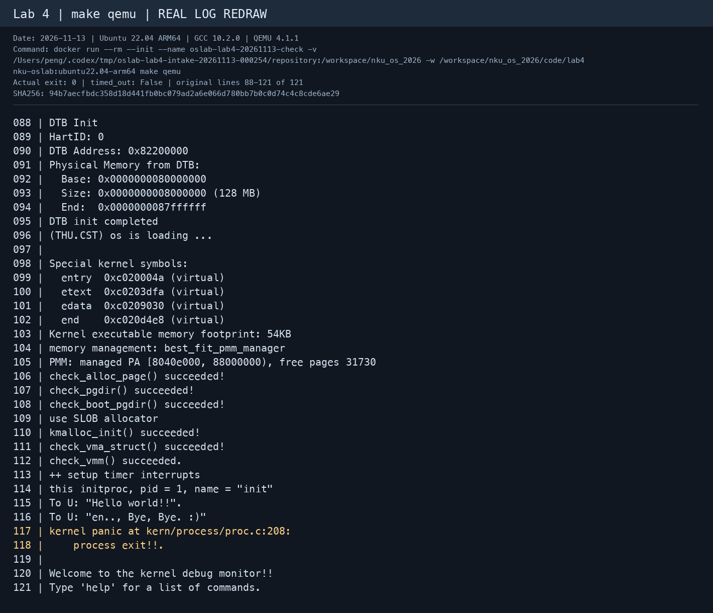

# 操作系统实验报告

## 实验基本信息

| 项目 | 内容 |
|------|------|
| **实验名称** | Lab 3: 断，都可以断（中断处理） |
| **小组成员** | 2413421-黄浩天、2413456-林涛、2413460-彭亚滨 |
| **完成日期** | 2026-11-02 |

### 小组分工

| 成员 | 负责的练习/模块 |
|------|----------------|
| 2413421-黄浩天 | Lab 2 代码移植（`best_fit_pmm.c`、`page_init()`、`init_pmm_manager()` 接入）；功能模块一 `trapentry.S`（`RESTORE_ALL`、`__alltraps`） |
| 2413456-林涛 | 功能模块二之 `interrupt_handler()`（时钟中断链路、统计输出与关机逻辑） |
| 2413460-彭亚滨 | 功能模块二之 `exception_handler()`（非法指令/断点的识别与 epc 修正）；运行环境适配（工具链、QEMU 4.1.1 重建）、`make grade` 验证、截图证据与报告统稿 |

报告撰写与交叉复核安排如下：

| 成员 | 主责章节与主要交付 | 交叉复核安排 |
|------|------------------|--------------|
| 黄浩天 | 4.1（Lab 2 移植）、4.2（功能模块一）；`trapentry.S`、`best_fit_pmm.c`、`pmm.c` 的移植与填写 | 复核林涛的时钟中断重挂顺序；复核彭亚滨的 epc 偏移与指令编码长度 |
| 林涛 | 4.3（`interrupt_handler`）；`SHUTDOWN_AFTER` 关机语义、ticks 计数守恒 | 复核黄浩天的 RESTORE_ALL 槽位对应关系；复核移植后的 `best_fit_check` 保持原样 |
| 彭亚滨 | 4.3（`exception_handler`）、4.4（环境适配）、第五章测试证据与统稿 | 复核黄浩天的 `__alltraps` 调用约定衔接；复跑 `make grade` 由成员共同承担 |

---

## 一、实验目的

本实验的主要目的是：

1. 理解 RISC-V 的中断（Interrupt）与异常（Exception）机制，掌握 `stvec`/`sepc`/`scause`/`sstatus` 等控制状态寄存器在 Trap 过程中的作用；
2. 掌握 Trap 前后上下文环境的保存与恢复方法，理解中断帧（TrapFrame）的结构设计以及精巧汇编代码（`SAVE_ALL`/`RESTORE_ALL`）如何与 C 语言处理函数衔接；
3. 在最小可执行内核基础上处理断点中断（`ebreak`）、非法指令异常与时钟中断，通过时钟中断的持续触发验证中断处理系统的正确性；
4. 学习使用 AI 辅助开发（按实验二设计的四段式提示词规范生成代码）的方法。

---

## 二、实验环境

| 成员 | AI 编程工具 | 底层模型 | 备注 |
|------|------------|---------|------|
| 2413421-黄浩天 | ZCode（终端 Agent） | GLM-5.3 | 延续 Lab 2 的四段式提示词规范 |
| 2413456-林涛 | Codex | GPT-6 | 负责中断处理函数生成 |
| 2413460-彭亚滨 | Codex | GPT-6 | 负责异常处理与环境问题定位 |

**本地运行环境：**

| 项目 | 内容 |
|------|------|
| 操作系统 | Windows + WSL2 Ubuntu 24.04 |
| 交叉工具链 | riscv64-linux-gnu-gcc 13.2（binutils 2.42） |
| 模拟器 | 自建 QEMU 4.1.1（riscv64-softmmu，与课程参考环境一致） |
| 实验代码 | 官方 `lab3.zip`（oslab 网站），原样置于 `code/lab3/` |

---

## 三、实验整体逻辑分析

### 3.1 本章节的逻辑主线

Lab 2 完成后，内核已经具备物理内存管理与 Sv39 引导页表，但仍是"一条直线跑到底"的程序：它无法对任何突发事件做出反应。本章的主线就是给内核装上"神经反射弧"——**中断处理机制**：

> 硬件发现事件（置 scause/sepc、跳 stvec）→ 汇编保存现场（trapframe）→ C 语言分诊处理（trap.c）→ 汇编恢复现场（sret 返回）。

围绕这条主线，指导书按以下顺序展开：先讲 RISC-V 特权级与中断路由（OpenSBI 委托 `medeleg`/`mideleg`，S 态自陷），再讲 `stvec` 的 Direct 模式与上下文切换的本质（把寄存器存进内存、再从内存恢复），然后实现中断入口点 `trapentry.S`，最后在 `trap.c` 里按 scause 分类处理，用时钟中断验证整条链路。"断，都可以断"：断点（`ebreak`）、非法指令、时钟节拍，最终都汇入同一个 `__alltraps` 入口。

### 3.2 功能的逐步实现

1. **首先补齐 Lab 2 依赖**：官方 Lab 3 框架在 `pmm.c` 与 `best_fit_pmm.c` 中留有 `lab2` 占位。物理内存管理是本实验的运行前提（时钟中断处理需要 `printfmt`、内核栈、`sbi_call` 等都依赖初始化完成的内核），必须先让框架编译、启动。
2. **接着实现 `RESTORE_ALL` 与 `__alltraps`（功能模块一）**：这是整条链路的"骨架"。`SAVE_ALL` 已由框架提供，学生按其槽位布局写出镜像操作 `RESTORE_ALL`，并在 `__alltraps` 中把 trapframe 指针交给 `trap()`。没有这一步，任何 Trap 都有去无回。
3. **然后实现 `interrupt_handler()` / `exception_handler()`（功能模块二）**：有了完整的进入-返回闭环，才轮到"分诊台"——按 scause 区分时钟中断、软中断、外部中断与非法指令、断点等异常，分别给出处理逻辑与规定的输出。
4. **最后用时钟中断验证**：`clock_init()` 挂上第一个时钟事件，`intr_enable()` 打开全局中断；此后每个时钟中断都会走一遍完整的 Trap 闭环。持续输出的 `100 ticks` 是整条链路正确性的直接证据；`make grade` 的三个用例（断点上下文 35/35、非法指令返回、时钟持续 200 ticks）分别对应链路的三个关键环节。

---

## 四、实验内容与实现

### 4.0 前置：Lab 2 代码移植（官方 lab2 占位填写）

**负责人：** 2413421-黄浩天

**涉及文件与函数：**

```c
// kern/mm/pmm.c
static void page_init(void);                       // lab2 占位：由 DTB 推导物理内存布局
static void init_pmm_manager(void);                // lab2 占位关联：接入 Best-Fit
// kern/mm/best_fit_pmm.c
static void best_fit_init(void);                   // lab2 占位
static void best_fit_init_memmap(struct Page *base, size_t n);
static struct Page *best_fit_alloc_pages(size_t n);
static void best_fit_free_pages(struct Page *base, size_t n);
static size_t best_fit_nr_free_pages(void);
const struct pmm_manager best_fit_pmm_manager;     // 官方仅给出 extern 声明
```

**功能说明：**

官方 Lab 3 框架把实验二的成果抽象成两处占位：`pmm.c` 缺 `page_init()`（物理内存探测与页描述符初始化），`best_fit_pmm.c` 缺整套 Best-Fit 分配器。与实验二自研结构（`pmm_layout.c`、`PMM_KIND` 开关、独立 dtb 解析）不同，官方框架已提供完整的 DTB 解析（`dtb_init()` 在 `kern_init()` 中被调用）和布局常量，因此移植的核心是**把实验二算法收编进官方骨架的接口约定**：

- `page_init()` 不再调用自建的 `pmm_compute_layout()`，改为内联完成同样的推导：`npage = 内存末页号`；描述符数组按页对齐紧邻内核镜像 `end` 之后；描述符之外剩余整页一次性 `init_memmap` 登记。
- Best-Fit 分配器逐函数移植：地址有序空闲链、整表扫描取最小可满足块、余量原位拆分、释放双向合并。
- `init_pmm_manager()` 接入 `&best_fit_pmm_manager`，保持实验二"Best-Fit 为默认分配器"的行为。
- 官方的 `basic_check()` 与 `best_fit_check()` 一字未动，作为移植正确性的验收标准。

#### 最终提示词

见 `report/prompt.md` 第 0 节（四段式：[PROMPT]/[RELY]/[GUARANTEE]/[SPECIFICATION]）。提示词的关键约束是：**只允许在官方标记的占位处填写代码，官方 check 函数一字不动，不得把实验二自建文件结构带进来**。

#### 实现迭代过程

**最终结果：** 经 2 次迭代，该模块最终：

- ✅ 官方框架编译通过并输出 `check_alloc_page() succeeded!`
- ✅ `best_fit_check()` 全部断言通过（官方验收标准）
- ✅ 启动输出与实验二的内存布局数据一致（描述符数、空闲页数）

**关键改进点总结：**

1. 第一次移植后链接报 `undefined reference to best_fit_pmm_manager`：实验二文件里管理器结构体是自带的，而官方 `best_fit_pmm.c` 只给了 extern 声明——结构体定义本身也属于"lab2 占位"的一部分，需一并补上。
2. 第二次按官方语义收紧了 `page_init()`：删去实验二对 `PHYSICAL_MEMORY_END` 的截断逻辑（官方 `memlayout.h` 无此常量），改为官方风格的断言（`mem_base == DRAM_BASE`）与输出格式，避免移植代码带进实验二的私有常量。

---

### 4.1 功能模块一：Trap 上下文恢复与 Trap 入口（trapentry.S）

**负责人：** 2413421-黄浩天

#### 模块功能描述

**需要实现/修改的函数：**

```asm
# kern/trap/trapentry.S
.macro RESTORE_ALL        # lab3 function1：与 SAVE_ALL 镜像的恢复宏
__alltraps:               # lab3 function1：SAVE_ALL 之后补齐 C 函数交接
```

**功能说明：**

`SAVE_ALL`（框架已提供）把 32 个通用寄存器和 4 个 CSR（sstatus/sepc/sbadaddr/scause）按 36 槽布局压到栈顶，形成一个 `struct trapframe`。本模块完成两件事：

1. **`RESTORE_ALL`**：Trap 处理结束后把现场原样恢复。它必须与 `SAVE_ALL` 逐槽对应，且有两处"陷阱"：
   - CSR 不能直接在内存与 CSR 之间传送，必须经通用寄存器中转——框架用 `csrrw s0, sscratch, x0` 把 trap 前 sp 从 sscratch 换出到 s0 再存入槽位 2，并把 sscratch 清零（为递归 Trap 标记内核态）；
   - **sp 必须最后恢复**：它既是访问 trapframe 的基址，又是最后才从槽位 2 取回的值。若先恢复 sp，后续所有槽位寻址全部失效。
2. **`__alltraps` 的 C 交接**：`SAVE_ALL` 完成后，sp 指向栈顶 trapframe。按 RISC-V 调用约定把指针放入 a0（`mv a0, sp`），`call trap` 进入 C 语言处理。`trap()` 返回后不需要任何栈修正——调用约定规定 sp 是被调用者保存寄存器，C 函数保证返回时 sp 不变，代码顺序落入 `__trapret`，由 `RESTORE_ALL + sret` 返回被打断的执行流。

整体闭环：`__alltraps → SAVE_ALL → trap() → __trapret → RESTORE_ALL → sret`。

#### 最终提示词

见 `report/prompt.md` 第 1 节。提示词的关键约束是：**RESTORE_ALL 的槽位布局必须与 SAVE_ALL 逐槽一致，sp（槽位 2）最后恢复，CSR 恢复先于通用寄存器恢复**；并明确指出 `SAVE_ALL` 对 x2(sp) 的特殊处理方式，要求 AI 不得按统一模板恢复全部寄存器。

#### 实现迭代过程

**最终结果：** 经 1 次迭代，该模块最终：

- ✅ 编译通过（`riscv64-linux-gnu-gcc` + binutils 2.42）
- ✅ `make grade` 用例 1 通过：`[Test 1] Trap entry and breakpoint return: PASS (35/35)`——官方测试在 `ebreak` 前给 26 个寄存器写入魔数、返回后逐一比对，证明 RESTORE_ALL 完整恢复了 35 个槽位
- ✅ 功能符合预期

**关键改进点总结：**

1. 提示词里显式列出"CSR 需经 s1-s4 中转、先写回 CSR 再恢复通用寄存器"的顺序约束，避免 AI 把 36 个槽位按同一模式一次性恢复（那样 s1-s4 的暂存值会在 CSR 写回前被覆盖）。
2. 在 `__alltraps` 中同时保留官方注释 `# sp should be the same as before "jal trap"`，并以一句注释说明其成立依据（调用约定的被调用者保存规则），使代码自解释。

---

### 4.2 功能模块二：中断与异常处理（trap.c）

**负责人：** 2413456-林涛（`interrupt_handler()`）、2413460-彭亚滨（`exception_handler()`）

#### 模块功能描述

**需要实现/修改的函数：**

```c
// kern/trap/trap.c  —— lab3 function2 占位
void interrupt_handler(struct trapframe *tf);
void exception_handler(struct trapframe *tf);
```

**功能说明：**

`trap_dispatch()`（框架提供）按 scause 最高位分诊：为 1 进入 `interrupt_handler()`，为 0 进入 `exception_handler()`。

**`interrupt_handler()`（2413456-林涛）**——中断分诊：

- `IRQ_S_TIMER`（时钟中断）：**必须先调用 `clock_set_next_event()` 重挂下一次事件**（OpenSBI 的一次性定时器，不重挂就只能收到一次中断），随后 `ticks++`；每满 `TICK_NUM`（100）次调用 `print_ticks()` 输出一行 `100 ticks`；统计输出累计达到 `SHUTDOWN_AFTER`（本实验取 10）次后调用 `sbi_shutdown()` 关机，验证系统可受控退出。
- `IRQ_S_SOFT` / `IRQ_S_EXT`：输出 `Supervisor software interrupt` / `Supervisor external interrupt` 提示。
- 其余：输出 `Unknown interrupt: cause <编号>` 并 `print_trapframe(tf)` 兜底。

**`exception_handler()`（2413460-彭亚滨）**——异常分诊：

- `CAUSE_ILLEGAL_INSTRUCTION`（0x2）：输出 `Illegal instruction at <epc>`，并**按触发指令的真实编码长度**前移 `tf->epc`。
- `CAUSE_BREAKPOINT`（0x3）：输出 `Breakpoint at <epc>`，同样按真实编码长度前移 `tf->epc`。
- 其余异常：`print_trapframe(tf)` 兜底输出完整现场（实验未要求具体恢复逻辑）。

"真实编码长度"是本模块的关键设计点。练习说明强调"不能假定所有异常都使用相同的 epc 偏移量，需要结合 RISC-V 指令编码规则判断"：RVC 压缩扩展下，汇编器会把 `ebreak` 自动收缩成 **2 字节的 `c.ebreak`**，而实验注入的非法指令 `.word 0x0000007b` 恒为 4 字节。因此不能写死 `+4`，实现中在异常处理时读取 epc 处指令半字的低两位：为 `0b11` 判为 32 位标准指令（+4），否则判为 16 位压缩指令（+2）。sret 返回后恰好跳过触发异常的指令，不会形成异常循环。

两个 handler 都不改 trapframe 中与本职责无关的字段，处理完成后交给统一的 `__trapret` 返回流程。

#### 最终提示词

见 `report/prompt.md` 第 2、3 节。两份提示词的关键差异：中断侧强调"**先重挂事件再计数**"与关机计数只统计 `print_ticks` 次数；异常侧强调"**不能对所有异常统一 epc+4，必须区分指令编码长度**"，并直接引用 grade.sh 的校验子串作为输出格式规格。

#### 实现迭代过程

##### 第一次迭代

**遇到的问题：**

- 问题 1：`sbi_shutdown()` 隐式声明编译错误（`-Werror` 下直接失败）。`trap.c` 的官方 include 列表里没有 `libs/sbi.h`。
- 问题 2：生成的初版把"每 TICK_NUM 次输出"实现成输出后直接关机，漏掉了 `SHUTDOWN_AFTER` 的"累计输出次数"语义，qemu 启动约 1 秒就退出，无法观察持续时钟中断。

**问题解决策略：**

- 针对问题 1：在提示词 [RELY] 中补充"sbi.h 提供 sbi_shutdown()，需在 trap.c 增加 include"——这是练习说明明示可用的框架接口，不算修改框架函数。
- 针对问题 2：在提示词 [SPECIFICATION] 中显式区分三个计数概念——`ticks`（每次时钟中断 +1）、`TICK_NUM`（输出周期）、`SHUTDOWN_AFTER`（关机阈值，统计的是输出次数）。

##### 第二次迭代：c.ebreak 压缩指令 bug（本实验最典型的 bug）

**遇到的问题：**

`make grade` 的 Test 2（非法指令，25 分）与 Test 3（时钟，40 分）通过后，Test 1（断点上下文，35 分）始终 `FAIL (register context)`。官方测试在 `ebreak` 前给 26 个寄存器写入魔数，返回后逐一比对；而我们对 trapframe 的转储显示 35 个槽位在 Trap 时刻全部正确——**保存与恢复两端看起来都是对的**。

**定位过程：**

1. 给 `/tmp` 评分副本的官方测试汇编打补丁，让每个寄存器检查点返回独立失败码：失败码 100 = 第一个检查点 `t0`；
2. 反汇编 `bin/kernel` 中 `test_lab3_register_context`，找到关键一行：

```
ffffffffc02019d0:  9002        ebreak        ← 实际是 2 字节的 c.ebreak！
ffffffffc02019d2:  10500513    li a0,261     ← epc += 4 会跳过这条指令
```

**根因：** 工具链开启 RVC 压缩扩展后，汇编器把 4 字节的 `ebreak` 自动收缩成 2 字节的 `c.ebreak`。处理函数写死的 `tf->epc += 4` 直接跳过了 `ebreak` 后面的第一条指令 `li a0,261`，`bne` 拿 a0 的旧值（0x53）与 t0 魔数（0x105）比较，第一个检查点即失败。这正是练习说明"不同异常对应的指令长度可能不同，不能假定所有异常都使用相同的 epc 偏移量"的深意。

**问题解决策略：** 在提示词 [SPECIFICATION] 中把"非法指令与断点各 +4"改为"读取 epc 处指令编码低两位动态判长（`0b11` → 4 字节，否则 → 2 字节）"，实现为 `instruction_length()` 辅助函数。修正后 Test 1 `PASS (35/35)`。

##### 最终结果

经 2 次迭代，该模块最终：

- ✅ 编译通过
- ✅ `make grade` 三项全部通过：`PASS (35/35)`、`PASS (25/25)`、`PASS (40/40)`，`Total Score: 100/100`
- ✅ `make qemu` 输出 10 行 `100 ticks` 后受控关机

**关键改进点总结：**

1. `SHUTDOWN_AFTER` 取值 10：既能在 `make qemu` 演示"输出 10 行 100 ticks 后受控关机"，又不会在 grade 用例（只需 200 ticks ≈ 2 秒）触发前提前退出。
2. 未知中断的 scause 编号输出前先屏蔽最高位（`(uintptr_t)tf->cause & ~(1UL << 63)`），使 `Unknown interrupt: cause 15` 直接呈现 IRQ 编号而非巨大数值。
3. epc 前移量按指令编码动态判定，兼容压缩与非压缩两类指令。

---

### 4.3 环境适配：官方框架在新工具链/新 QEMU 上的四个问题（bug 与解决）

**负责人：** 2413460-彭亚滨（记录），全组复现确认

按实验要求记录本实验中实际出现的 bug 及解决过程。官方代码内容全程未被修改，所有问题都出在**构建与运行环境**与课程参考环境的差异上：

| # | 现象 | 根因 | 解决 |
|---|------|------|------|
| 1 | `trapentry.S` 汇编报 `unknown CSR 'sbadaddr'`（官方 `SAVE_ALL` 第 47 行） | `sbadaddr` 是 priv-1.9 旧名（地址 0x143，与现名 `stval` 同址）；binutils ≥ 2.36 移除了旧名助记符。系统 riscv64-unknown-elf- 工具链是 GCC 15.1 + binutils 2.45 | 改用 Ubuntu 的 `riscv64-linux-gnu-`（binutils 2.42，仍保留旧名），`make GCCPREFIX=riscv64-linux-gnu-`。QEMU 按地址译码 CSR，运行时不受助记符影响 |
| 2 | 修复 #1 后，内核第一条指令就 `fault_store`（tval=0xffffffffc0206000） | Ubuntu 交叉 GCC 默认 PIE，`.S` 中的 `la` 被展开成 **GOT 间接寻址**（`auipc+ld`），在开启页表前的裸机阶段取出的绝对 VA 不可用 | `Makefile` 的 `CFLAGS` 追加 `-fno-pie -fno-pic`（唯一的环境层 Makefile 改动，注释说明），`la` 恢复为标准 `auipc+addi` PC 相对寻址 |
| 3 | `-bios default` 下 OpenSBI 1.3 打印 `Domain0 Next Address: 0x0`，内核不被加载执行 | QEMU 8.2.2 自带的 OpenSBI 是 **fw_dynamic** 型，下一跳地址需 QEMU 通过动态配置传入；`-device loader` 只搬数据不传地址，故 next_addr=0 | 官方命令组合是为 QEMU 4.1.1（自带 **fw_jump** 型 OpenSBI 0.4，固定跳转 0x80200000）设计的，需恢复课程 QEMU 4.1.1 环境（见 #4） |
| 4 | 改用 `-kernel` 让 8.2.2 正确跳转后，仍在 `sfence.vma` 后取指 fault（`exec_page_fault`） | 新版 QEMU TCG 在 `csrw satp` 提交后立即按新地址空间翻译；官方 `entry.S` 的物理 PC（0x80200038）在 Sv39 下未映射。旧版 QEMU 4.1.1 的 TCG 允许该翻译块一次执行完，不触发此问题 | 本地重建 QEMU 4.1.1：无 sudo，用 `apt-get download` + `dpkg -x` 把 glib2/pixman/libfdt 开发包解包到用户前缀（`~/qemu-deps`），在其中完成 riscv64-softmmu 构建（`~/qemu-build/qemu-system-riscv64`，源码经 SHA-256 校验）。构建脚本与产物不入仓库（`.gitignore` 已覆盖） |

**结论：** 课程参考环境（QEMU 4.1.1 + 保留旧 CSR 助记符的工具链）是官方框架能直接构建运行的必要条件；我们的仓库只额外带了一句带注释的 `CFLAGS` 追加，其余环境差异全部在环境层解决，并在本章留档。

---

## 五、测试与验证

### 5.1 `make qemu`：时钟中断持续触发与受控关机

内核启动 → DTB 初始化 → Best-Fit 接入 → `check_alloc_page() succeeded!` → 时钟中断每秒输出一行 `100 ticks` → 达到 `SHUTDOWN_AFTER` 次后 `sbi_shutdown()` 受控关机（QEMU 进程正常退出）：



### 5.2 `make grade`：官方三项测试全部通过（100/100）

官方 `make grade` 通过 `tools/inject.py` 向临时副本注入三组测试后逐项评分：

- Test 1（断点上下文）：`[Test 1] Trap entry and breakpoint return: PASS (35/35)` —— 验证 `__alltraps`/`RESTORE_ALL` 完整保存恢复 35 个槽位；
- Test 2（非法指令返回）：`[Test 2] Illegal instruction return: PASS (25/25)` —— 验证 `exception_handler` 的 epc 前移与兜底输出；
- Test 3（持续时钟）：`[Test 3] Sustained supervisor timer: PASS (40/40, ticks=200)` —— 验证 `interrupt_handler` 的持续重挂。

```
  - trap entry, register restore, and breakpoint EPC: PASS (35/35)
  - illegal instruction EPC advance and return: PASS (25/25)
  - re-armed supervisor timer and repeated trap return: PASS (40/40)

Total Score: 100/100
```


---

## 六、实验总结与收获

### 对操作系统的理解

**1. 本实验重要知识点与 OS 原理的对应**

| 实验知识点 | OS 原理知识点 | 含义、关系与差异 |
|-----------|--------------|----------------|
| TrapFrame（36 槽：32 通用寄存器 + 4 CSR）与 `SAVE_ALL`/`RESTORE_ALL` | 上下文切换 / 现场保护 | 原理课讲"保存现场、恢复现场"的抽象；本实验把它落到具体槽位布局：结构体内存连续排列与汇编 `STORE/LOAD` 偏移一一对应，`sp` 的特殊处理体现"布局与访问基址耦合"的工程约束。差异：原理上"进程上下文"还包含地址空间与内核栈，本实验只保存 CPU 寄存器 |
| `stvec` Direct 模式统一入口 + `scause` 分诊（`trap_dispatch`） | 中断向量表 / 中断分类处理 | 原理教材的中断向量表按类型索引不同入口（Vectored 模式）；RISC-V `stvec` 最低两位编码模式位，本实验用 Direct 模式（单入口）+ 软件分诊，属于"查表在硬件还是软件"的实现取舍 |
| `sret` 与 sstatus.SPP/SPIE 硬件联动 | 特权级切换 | 原理课讲"用户态/核心态切换"；RISC-V 把状态记录（SPP）、中断使能保存恢复（SIE/SPIE）全部硬件化，软件只需恢复 trapframe 中的 sstatus 再 `sret`。差异：本实验全程 S 态自陷，未涉及 U→S |
| `ebreak`/非法指令后按编码长度前移 `tf->epc` | 精确异常（precise exception） | 原理课要求异常返回点"像没发生过一样"；RISC-V 的精确异常保证 sepc 语义，软件只需按指令编码长度前移 epc。差异：中断（异步）返回原指令，异常（同步）返回下一条；且 RVC 下指令有 2/4 字节两种编码，长度要读指令本身判断——本实验的 `c.ebreak` bug 正是这个差异的体现 |
| `local_intr_save/restore`（`pmm.c` 中框架已用） | 原子操作 / 临界区 | Lab 3 补充材料给出的 `sync.h`：修改空闲链表前关中断。与原理的"信号量/PV 操作"相比，这是单核下最朴素的临界区手段；多核下不够，需要锁 |
| OpenSBI `sbi_set_timer` 一次性定时 + 每次中断重挂 | 时钟与节拍（tick） | 原理课的"系统时钟节拍"是 OS 时间管理的基准；本实验体现 One-shot 定时器的通用模式：不依赖周期性硬件，软件重挂即可。差异：真实 OS 还会维护墙钟、轮转调度用的 runqueue，本实验只有 ticks 计数 |

**2. OS 原理中重要但本实验未对应的知识点**

- **中断的嵌套与优先级管理**：进入 `__alltraps` 后 SIE 硬件清零，处理期间不再响应中断；真实内核需要可嵌套的中断优先级（PIC 级联、中断亲和性）。
- **Vectored 中断模式**：`stvec` 的 Vectored 分支（最低两位=01）由硬件按 cause 索引入口，本实验只用 Direct 模式。
- **进程上下文切换**：本实验保存/恢复的是"同一条执行流"的现场；调度器语境下的上下文切换还涉及地址空间（satp）、内核栈指针（sscratch 存内核栈顶）与浮点/向量寄存器。
- **设备中断的下半部机制**：时钟中断之外，真实 OS 需要处理网卡/磁盘等外部中断并把耗时工作推迟到下半部（softirq/tasklet），本实验的外部/软中断仅打印提示。
- **多核下的中断控制器**（MSI/PLIC/APLIC）与核间中断（IPI）：QEMU virt 单 hart 且时钟直接走 ACLINT，未涉及。
- **中断驱动的调度抢占**：时钟节拍在原理上是时间片轮转的触发源，本实验尚未有进程概念，ticks 只做计数与统计。

### AI 协作开发的经验

1. **把"约束"写进提示词比把"答案"写进提示词更有效**。功能模块一的提示词没有给出任何汇编指令序列，只给出槽位布局、sp 的特殊性、调用约定与"不得修改"清单；生成的 `RESTORE_ALL` 一次通过。约束式描述天然形成验收标准。
2. **官方框架是最高优先级的上下文**。凡是让 AI 先读官方 `SAVE_ALL`/`grade.sh` 再写提示词的模块，输出都更贴合实验要求；`grade.sh` 中的校验子串实际上就是练习的"输出格式规格"，把它直接作为 [SPECIFICATION] 的 Case 写进提示词，避免了格式反复。
3. **环境类 bug 要让 AI 给出因果链而非补丁**。四个环境问题（CSR 助记符、PIE、fw_dynamic、satp 翻译时机）如果只要求"让它能跑"，AI 会提出修改官方源码的捷径（比如把 `sbadaddr` 改成 `stval`、把 `entry.S` 加跳板）；明确"不得修改官方指令序列"的操作要求后，AI 才转向工具链选择与 QEMU 版本这些正确的环境层方案。
4. **AI 生成的代码仍要逐行对照体系结构手册与真实机器复核**。本实验最典型的例子：AI 生成的异常处理把 `epc` 前移写死为 4 字节，单元逻辑上"看起来正确"，却在真实工具链下失败——汇编器把 `ebreak` 压缩成了 2 字节的 `c.ebreak`。最终靠"失败码插桩 + 反汇编"定位到指令编码层面。与规范强相关的细节（指令编码长度、CSR 命名时代、调用约定保存关系），验证依据只能是手册与反汇编输出，而不是 AI 的自信程度。
