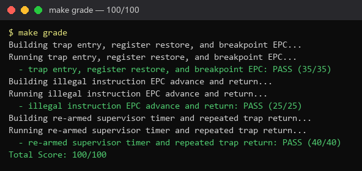
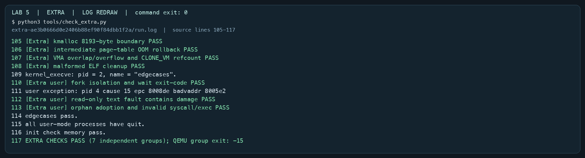
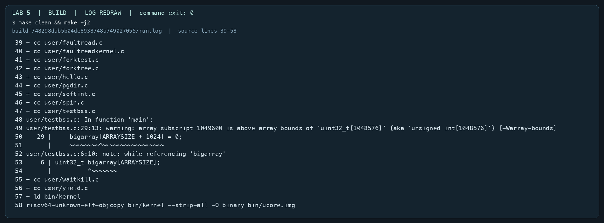

# 操作系统实验报告

## 实验基本信息

| 项目 | 内容 |
|------|------|
| **实验名称** | Lab 4：进程管理 |
| **小组成员** | 2413421-黄浩天、2413456-林涛、2413460-彭亚滨 |
| **完成日期** | 2026-11-13 |

### 小组分工

沿用此前实验的模块责任安排：

| 成员 | 负责的练习/模块 |
|------|----------------|
| 2413421-黄浩天 | 前置物理内存与 Trap 恢复接口、虚拟内存页操作；报告 4.1、4.2 |
| 2413456-林涛 | 进程创建及初始化；报告 4.3 |
| 2413460-彭亚滨 | 进程调度、环境与测试证据、报告 4.4—4.6、第五章及统稿 |

上述表格表示小组责任分配。本次实现、命令执行、图片整理与报告撰写由 Codex 辅助完成；本次记录不包含成员个人复跑或交叉审核结果。

## 一、实验目的

1. 在物理页分配和 Sv39 页表上维护映射、权限、引用计数与 TLB 的一致性，理解 VMA 描述与硬件页表的区别。
2. 用 PCB、内核栈、trapframe 和 context 创建内核线程，区分继承现有现场的 idle 与通过 do_fork 创建的 init。
3. 实现协作调度和上下文切换，理解调度策略、地址空间切换与寄存器恢复各自的职责。
4. 用课程提示词模板表达接口前后条件，并结合原评分和补充测试检查生成代码。

## 二、实验环境

| 成员 | AI 编程工具 | 底层模型 | 备注 |
|------|------------|---------|------|
| 2413421-黄浩天 | ZCode（终端 Agent） | GLM-5.3 | 按此前实验记录沿用的工具配置 |
| 2413456-林涛 | Codex | GPT-6 | 按此前实验记录沿用的工具配置 |
| 2413460-彭亚滨 | Codex | GPT-6 | 按此前实验记录沿用的工具配置；本次由 Codex 执行实现与验证 |

| 项目 | 本次实际环境 |
|------|-------------|
| 宿主 | macOS 26.6.2，Docker |
| 构建容器 | Ubuntu 22.04 ARM64，镜像 nku-oslab:ubuntu22.04-arm64 |
| 镜像 ID | sha256:e6d3074984eb2fd3a537055532d013e977a3cf847a5cc76990893235deb38278 |
| 交叉编译器 / 调试器 | riscv64-unknown-elf-gcc 10.2.0 / GDB 12.1 |
| 模拟器 / 固件 | QEMU 4.1.1 / 默认 OpenSBI v0.4 |
| 目标 | RV64，Sv39，单核；DTB 报告 128 MiB RAM |
| 框架 | 用户提供 lab4.zip，内部目录 lab4_new；SHA-256：7a92f243f88ca9a4ec78b52e554a14d78a41bbf6a79a1275f6cc929aaebceba2 |

手册采用课程网站新版镜像 Lab 4，页面构建时间为 2026-11-10，工作区于 2026-11-11 更新；课堂补充来源为 2026-11-10 智能纪要。模板保存在[实验报告模板.md](实验报告模板.md)，代码入口为 `code/lab4/`，复现命令见[仓库 README](../README.md)。前置功能依据当前框架重新实现，没有复制历史实验答案。

## 三、实验整体逻辑分析

### 2.1 本章节的逻辑主线

执行链为 `kern_init → pmm_init → pic_init/idt_init → vmm_init → proc_init → cpu_idle → schedule → proc_run → switch_to`。前半段建立可用内存和中断环境，后半段把“已创建的 PCB”变成 CPU 上实际执行的线程。

VMA 记录某段虚拟地址的范围与用途，页表记录硬件翻译关系，两者不能互相替代。本实验保留框架的 VMA 创建、插入和查找实现，使用预先建立的映射，不实现缺页分配或页面置换。各内核线程共享同一内核根页表，拥有独立内核栈和寄存器现场，`mm==NULL` 表示没有用户地址空间。

### 2.2 功能的逐步实现

物理页分配和 Trap 恢复是前置条件。启动时先使用临时 1 GiB 叶项，再建立 4 KiB 页表，让代码、只读数据和可写内存获得不同权限；映射增删维护引用计数，防止线程使用的内存被提前释放。

`proc_init` 把当前启动现场登记为 idle，然后用 `kernel_thread → do_fork` 创建 init，分配 PCB 和栈，并在栈顶布置首次运行的中断帧。`schedule` 选择就绪线程，`proc_run` 更新 current 与 satp，`switch_to` 恢复 context。新线程的 ra 指向 `forkret`，因此首次恢复经过 `forkrets → __trapret → sret → kernel_thread_entry`，最终调用线程函数。

## 四、实验内容与实现

### 4.1 前置功能：物理内存与中断接口

**负责人：** 2413421-黄浩天；时钟和异常接口按此前责任由林涛、彭亚滨对应维护。

#### 模块功能描述

`default_pmm.c` 保留框架文件名和 `default_pmm_manager` 导出符号，内部实现 best-fit。空闲块按地址排序；分配遍历链表选择最小足够块，余块留在原位置；释放先插入地址顺序，再合并前后相邻块。各步骤同步 `nr_free`、块头 `property` 与 `PG_property`，没有改动 `basic_check` 和 `best_fit_check`。

`page_init` 从 DTB 获取 RAM 基址和长度，用 `PHYSICAL_MEMORY_OFFSET` 做虚实地址转换，保留内核及 Page 数组。框架的 `KMEMSIZE/KERNTOP` 将管理上限限制到物理地址 0x88000000；本次 DTB 恰为 128 MiB，不据此声称支持任意 RAM 布局。

`RESTORE_ALL` 恢复 sstatus/sepc，再恢复通用寄存器，最后恢复 sp。`__alltraps` 将当前 sp 作为 trapframe 指针传给 `trap`。时钟处理先设置下一事件再增加 ticks；异常处理区分 2/4 字节指令，其余异常输出现场并停止。这里保留的是内核态 Trap 路径，没有实现用户态与内核态栈切换。

#### 最终提示词

````markdown
[PROMPT]
**任务**：补齐当前 Lab 4 框架中 lab2/lab3 标记处的物理内存分配、内存探测和中断恢复代码。
**操作要求**：在 kern/mm/default_pmm.c、pmm.c、kern/trap/trap.c、trapentry.S 内实现；不迁移旧实验整份文件，不改原检查函数和断言。保留原任务注释并填对应成员学号。
**输出要求**：可交叉编译的前置实现，以及本次启动和原框架评分结果。

[RELY]
struct Page 含 ref、flags、property、page_link；free_area_t 含 free_list、nr_free；pmm_manager 提供 init/init_memmap/alloc_pages/free_pages/nr_free_pages/check。
DTB 接口 get_memory_base/get_memory_size；地址偏移 PHYSICAL_MEMORY_OFFSET；pages 按 nbase 对应 DRAM_BASE。trapframe 为 32 个通用寄存器槽和 status/epc/badvaddr/cause 四槽，每槽 REGBYTES=8。

[GUARANTEE]
实现 best-fit 管理器的初始化、分配、释放和空闲页计数，以及 static void page_init(void)。补齐 void interrupt_handler(struct trapframe *tf)、void exception_handler(struct trapframe *tf)、RESTORE_ALL 和 __alltraps 调用 trap 的过程。可增加模块内静态辅助函数。

[SPECIFICATION]
**Pre-Condition**：单核 RISC-V Sv39，启动巨页已建立；DTB 已解析；分配请求 n>0，释放对象属于当前已分配区间。
**Post-Condition**：空闲链表按物理地址排序，分配选择最小可容纳块，释放后合并相邻区间，空闲总数与块长度一致。内存描述符覆盖框架允许的 RAM，内核及描述符占用不进入空闲表。Trap 返回恢复原寄存器、sstatus 和 sepc，最后恢复 sp。
**Case 1**：无合适连续块时返回 NULL，不改变链表和计数。
**Case 2**：时钟中断先重挂下一事件再增加 ticks；断点/非法指令依据指令低两位区分 2/4 字节并前移 epc，其他异常输出现场并 panic。
**Requirements**：保留 basic_check、best_fit_check 和当前框架中断初始化；不引入 Lab 3 自动关机逻辑，不实现用户态栈切换。
````

#### 实现迭代过程

前置代码完成后首次交叉编译成功，原分配器检查、页表检查和 VMA 检查均在 QEMU 中执行。没有把 Lab 3 的计时自动关机行为带入 Lab 4。框架 `kmalloc.c` 原有整数向指针转换警告保留，未为消除警告修改课程提供的分配器。

### 4.2 功能模块一：虚拟内存页操作

**负责人：** 2413421-黄浩天。

#### 模块功能描述

```c
int page_insert(pde_t *pgdir, struct Page *page, uintptr_t la, uint32_t perm);
void page_remove(pde_t *pgdir, uintptr_t la);
static void page_remove_pte(pde_t *pgdir, uintptr_t la, pte_t *ptep);
```

`page_insert` 先查找或创建叶项，失败时返回 `-E_NO_MEM`；得到叶项后增加新页引用。原项指向同一页时抵消这次引用增加，仅更新权限；原项指向另一页时撤销旧映射，引用归零才释放旧页。新叶项写入后执行地址级 `sfence.vma`。

`page_remove` 使用 `create=0`，找不到项时直接返回。辅助函数先清叶项、刷新 TLB，再减少引用并按需释放物理页。重复删除无效映射不会再次减引用。删除后空的中间页表可以保留；它们的生命周期与映射数据页不同。

原 `get_pte` 在新建上层表后，可能因下层表分配失败而留下空表。实现记录本次新建的父表，第二次分配失败时清根项并释放父表，不撤销调用前已存在的页表。高层若为巨页叶项则返回 NULL，避免把数据内容当作下一级页表。

启动巨页不能直接交给普通三级遍历。`pmm_init` 分配新根，先映射整个可管理直映区，再将 `.text` 改为 R/X、`.rodata` 改为 R，其余为 R/W。链接脚本把只读数据起点对齐到页边界，避免与代码共页。启动根增加临时恒等映射，以覆盖启用 satp 后仍处在物理 PC 的取指；切入新根后不再保留该恒等映射。

#### 最终提示词

````markdown
[PROMPT]
**任务**：完成 kern/mm/pmm.c 的页映射建立、替换与删除，并为启动巨页切换到细粒度页表提供初始化。
**操作要求**：保留原 check_pgdir/check_boot_pgdir；不改测试预期。保留 get_pte 的接口，增加中间表分配失败回滚和高层叶项拒绝；更新 TLB 时约束编译器内存重排。
**输出要求**：可运行的 page_insert/page_remove，原 PMM 评分及 OOM、实际重映射、权限补测。

[RELY]
get_pte(pgdir,la,create)、pte_create、pte2page、page_ref_inc/page_ref_dec、free_page、tlb_invalidate；PTE_V/R/W/X/U/A/D；Sv39 地址索引 PDX1/PDX0/PTX。boot_pgdir_va/pa 分别保存根表的虚拟/物理地址。

[GUARANTEE]
int page_insert(pde_t *pgdir, struct Page *page, uintptr_t la, uint32_t perm);
void page_remove(pde_t *pgdir, uintptr_t la);
允许增加 static void page_remove_pte(pde_t *pgdir, uintptr_t la, pte_t *ptep)，以及启动页表构造所需代码；不把高层巨页当作下一级页表。

[SPECIFICATION]
**Pre-Condition**：pgdir 为有效根表，page 为有效物理页；目标通过普通 4 KiB 叶项维护。启动阶段仍能用临时巨页访问页表页。
**Post-Condition**：成功返回 0，目标叶项指向 page，权限使用传入位，引用计数反映映射数量。页表分配失败返回 -E_NO_MEM，数据页引用与旧映射不变，本次新建但未完成的父表被回收。删除未映射地址不报错。
**Case 1**：相同物理页重复插入只更新权限，引用计数不净增，不释放原页。
**Case 2**：替换不同页时撤销旧映射、减少旧页引用，归零才释放，随后发布新映射。
**Case 3**：删除清空叶项并执行 sfence.vma，引用归零后释放物理页；空中间表可保留。
**Requirements**：建立新根表，代码段 R/X、只读数据段 R、其余直映区 R/W；切换 satp 后刷新 TLB。启用分页后的下一条指令仍须可取指，使用临时恒等映射过渡。
````

#### 实现迭代过程

上述页表初始化与 OOM 回滚在首次实现时加入，不是运行失败后才定位到的故障。原 PMM 注入测试检查重插、替换、权限、引用计数和重复删除；补测另行在第 1、2 次页表分配时注入失败，确认根项、引用及空闲页计数恢复，并通过实际虚拟地址写入检查重映射后的 TLB 行为。

### 4.3 功能模块二：进程创建及初始化

**负责人：** 2413456-林涛。

#### 模块功能描述

```c
static struct proc_struct *alloc_proc(void);
void proc_init(void);
int kernel_thread(int (*fn)(void *), void *arg, uint32_t clone_flags);
int do_fork(uint32_t clone_flags, uintptr_t stack, struct trapframe *tf);
static void copy_thread(struct proc_struct *proc, uintptr_t esp, struct trapframe *tf);
static int copy_mm(uint32_t clone_flags, struct proc_struct *proc);
```

`alloc_proc` 清零 PCB，设置 `PROC_UNINIT`、pid=-1 和内核根表物理地址，并初始化两条链。`proc_init` 初始化哈希桶和进程链表，把启动现场登记为 PID 0 的 idle，沿用 bootstack，置 `need_resched=1`，再创建 PID 1 的 init。idle 不加入普通线程链表，由调度器单独保底。

`kernel_thread` 用局部 trapframe 保存函数与参数：s0 是函数，s1 是参数，epc 指向 `kernel_thread_entry`。SPP=1 表示 sret 后仍在 S 态，SPIE=1 使返回后可响应中断，SIE=0 避免在恢复尚未结束时开中断。

`do_fork` 依次检查数量上限、分配 PCB、分配内核栈、处理 mm、复制现场。栈分配失败只释放 PCB；copy_mm 失败则先释放栈再释放 PCB。资源准备好后，关中断分配 PID、登记哈希和全局链、增加计数，再将线程唤醒。失败对象不会提前进入可调度集合。

本阶段 `copy_mm` 断言 `current->mm==NULL`，不复制用户地址空间。`copy_thread` 在两页内核栈顶放置 36 槽 trapframe，设置子线程 a0=0，默认运行栈指向该帧下方；context 的 ra 指向 forkret，sp 指向该帧。线程首次运行时，forkrets 把帧地址放入 sp，复用 Trap 返回汇编。context 只保存跨函数调用所需的 14 个寄存器，trapframe 保存异常返回所需的更多现场，二者用途不同。

#### 最终提示词

````markdown
[PROMPT]
**任务**：实现 kern/process/proc.c 中的 PCB、idleproc 和 initproc 创建链路。
**操作要求**：使用当前 proc_struct、context、trapframe 和链表接口；保留 get_pid、find_proc、init_main 与 do_exit 的框架语义，失败时按资源获得的逆序释放。
**输出要求**：idle PID 0、init PID 1 及可供调度器运行的新线程，原 Process Create 评分结果。

[RELY]
proc_struct 中 state/pid/runs/kstack/need_resched/parent/mm/context/tf/pgdir/flags/name/list_link/hash_link；kmalloc/kfree、setup_kstack/put_kstack、get_pid/hash_proc、wakeup_proc；CLONE_VM、bootstack、boot_pgdir_pa；kernel_thread_entry、forkret、forkrets、__trapret。

[GUARANTEE]
static struct proc_struct *alloc_proc(void);
void proc_init(void);
int kernel_thread(int (*fn)(void *), void *arg, uint32_t clone_flags);
int do_fork(uint32_t clone_flags, uintptr_t stack, struct trapframe *tf);
static void copy_thread(struct proc_struct *proc, uintptr_t esp, struct trapframe *tf);
static int copy_mm(uint32_t clone_flags, struct proc_struct *proc);

[SPECIFICATION]
**Pre-Condition**：物理页分配、kmalloc 和 VMA 管理已初始化；本实验只创建 current->mm==NULL 的内核线程；调用 do_fork 时 current 和 tf 有效。
**Post-Condition**：新 PCB 初值安全，PID 未分配时为 -1，页表物理地址指向内核根表；成功 fork 返回正 PID，失败返回负错误码，未登记失败对象。idle 使用现有启动栈，init 使用独立两页内核栈。
**Case 1**：线程数已达 MAX_PROCESS 返回 -E_NO_FREE_PROC；PCB/栈分配失败返回 -E_NO_MEM，释放已获得资源。
**Case 2**：copy_mm 保持用户地址空间为空；copy_thread 将 trapframe 放在内核栈顶，子线程 a0=0，context.ra=forkret，context.sp 指向 trapframe。
**Requirements**：kernel_thread 的 s0/s1 保存函数和参数，epc 为 kernel_thread_entry；SPP=1、SPIE=1、SIE=0。PID 分配、哈希/进程链表登记、计数和唤醒在关中断区域完成。
````

#### 实现迭代过程

首次运行已创建 init 并输出 PID 与名称，原 Process Create 测试检查 idle 的空白字段、启动栈、init 父子关系与恢复入口。没有实现 do_exit 的回收逻辑；普通启动中线程返回后出现的 `process exit!!` 来自框架原有占位函数，不能解释为完整进程生命周期已经实现。

### 4.4 功能模块三：进程调度

**负责人：** 2413460-彭亚滨。

#### 模块功能描述

```c
void cpu_idle(void);
void schedule(void);
void proc_run(struct proc_struct *proc);
void switch_to(struct context *from, struct context *to);
```

`cpu_idle` 检查重调度标志。`schedule` 关中断、清当前标志，从当前线程后继循环扫描；当前为 idle 时从表头开始。只选 `PROC_RUNNABLE`，遇到表头跳过，整圈无候选则选 idle。选中自身只增加运行次数，不做无意义切换。手册称其为 FIFO，但这里的具体行为是按链表顺序循环选择；本实验没有定时抢占与时间片耗尽逻辑。

`proc_run` 在关中断区域保存旧 current，发布新 current，将 `MODE=8` 和根页表物理页号写入 satp，并刷新 TLB，再调用 switch_to。RISC-V 写 satp 不等于自动刷新 TLB，不能照搬 x86 写 CR3 的说明，也不能使用框架 `lsatp()` 中的 Sv32 写法。

`switch.S` 按 context 偏移 0—104 字节保存和恢复 ra、sp、s0—s11，最后 ret。a0/a1 分别是 from/to 指针，不在加载新现场时覆盖。调用者需要跨调用存活的 caller-saved 值由调用约定处理；被调用者保存寄存器则由 switch_to 维护。旧线程被切回来时，沿原函数调用继续执行并恢复其原中断状态。

#### 最终提示词

````markdown
[PROMPT]
**任务**：补齐 proc.c、kern/schedule/sched.c 和 kern/process/switch.S，让新线程获得 CPU 并可协作让出。
**操作要求**：按现有链表循环选择 runnable 线程；使用 RISC-V Sv39 satp，不调用 Sv32 遗留 lsatp。汇编偏移严格对应 struct context。
**输出要求**：从 idle 切换到 init 的启动结果、原 Schedule 评分，以及多线程寄存器和 idle 保底补测。

[RELY]
current/idleproc/proc_list、PROC_RUNNABLE、need_resched/runs；local_intr_save/local_intr_restore；SATP_MODE_SV39、RISCV_PGSHIFT、flush_tlb；context 按 ra、sp、s0 至 s11 排列，共 14 个 uintptr_t。

[GUARANTEE]
void cpu_idle(void);
void schedule(void);
void proc_run(struct proc_struct *proc);
void switch_to(struct context *from, struct context *to);

[SPECIFICATION]
**Pre-Condition**：进程链表和 idleproc 已初始化，目标线程已有有效根页表和恢复现场；单核且调度发生于协作调用点。
**Post-Condition**：schedule 清除当前重调度标记，选中 runnable 线程并增加其 runs；无合适线程时选 idle。proc_run 在屏蔽中断时更新 current、satp，刷新 TLB，再切换寄存器；旧线程恢复后还原其调用时中断状态。
**Case 1**：idle 的扫描起点为链表头；普通线程的扫描起点为自身后继。表头仅作哨兵，不作为 PCB。
**Case 2**：选中自身时不调用 switch_to；首次进入新线程则沿 forkret/forkrets/__trapret 恢复合成 trapframe 并 sret。
**Requirements**：switch_to 保存并恢复 ra/sp/s0-s11，使用 8 字节槽和 a0/a1 指针。cpu_idle 持续检测 need_resched，不添加时间片抢占。
````

#### 实现迭代过程

原 Schedule 测试创建两个线程并反复协作调度，结果通过。补测使用独立汇编给 s0—s11 装入不同常量，跨三次 schedule 检查值、sp 和正常返回；两个线程均完成。补测还把普通线程置为睡眠，实际切回 idle，再由测试唤醒原线程，检查保底路径。

### 4.5 扩展练习：中断、分页与 PID

**负责人：** 2413460-彭亚滨；分析覆盖手册两项 Challenge，并补充纪要提出的 PID 问题。

#### local_intr_save 与 local_intr_restore 如何开关中断

`__intr_save()` 读取 sstatus.SIE。原来为 1 时执行 `intr_disable()` 清 SIE 并返回 1；原来为 0 时返回 0，不额外改变状态。`__intr_restore(flag)` 只在 flag 为真时重新置 SIE。因此内层在外层已关中断时得到 0，恢复内层不会提前开中断，外层恢复才重建进入前的状态。调用区间不得自行破坏这一约定，成对调用才能保持含义。

屏蔽的是 S 态可屏蔽中断，不屏蔽同步异常，也不是多核锁。单核下能防止中断处理与线程切换交错，但多核仍需自旋锁、内存顺序和远程 TLB 协调。补测分别检查内外层的 SIE 状态及最终恢复值。

#### get_pte 两段代码为何相像

| 模式 | 级数 | 各级 VPN 位数 | PTE 大小 | 普通页内偏移 |
|------|------|---------------|----------|-------------|
| Sv32 | 2 | 10 + 10 | 4 字节 | 12 位 |
| Sv39 | 3 | 9 + 9 + 9 | 8 字节 | 12 位 |
| Sv48 | 4 | 9 + 9 + 9 + 9 | 8 字节 | 12 位 |

每一级都先用 VPN 索引表项、检查有效位；缺失且允许创建时分配一页、清零并登记，再从 PPN 找到下一级。Sv39 在叶表之前有两级非叶表，所以出现两段结构相同的代码；Sv48 会再多一级，Sv32 只有一级非叶表。它们体现同样的层级遍历，但索引宽度、PTE 宽度、级数、satp 模式及合法地址范围不同，不能直接复制常量。

R/W/X 不全为零表示叶项，高层叶项可表示大页。本实现用专门的启动映射后切换普通页表，普通 get_pte 遇到高层叶项会拒绝继续向下走，不提供巨页拆分或巨页插入功能。

#### 查找与分配是否应拆开

合并接口用 create 参数减少重复遍历，在实验中调用简洁；代价是看似“查找”的调用可能分配和修改页表，失败路径也更复杂。`create=0` 便于只读查询，`create=1` 必须检查内存不足。当前补充的父表回滚说明了副作用需要有明确归属。

较大系统可拆成 `walk_pte` 与 `ensure_pte`，共享无副作用的逐级遍历助手，并显式说明锁和新分配页归属。拆分本身不保证正确，还要处理并发安装、失败回滚、巨页和 TLB；本实验保留课程接口，通过参数、注释和错误处理约束副作用。

#### 课堂补充：PID 的循环分配与复用

当前 `get_pid` 维护 last_pid 与 next_safe。当达到 MAX_PID 时从 1 重新开始，避开 idle 的 0；需要重新扫描时遍历 proc_list，跳过已占用编号并记录下一占用边界。`MAX_PID > MAX_PROCESS` 为寻找空号提供空间，do_fork 在关中断区完成分配与登记。该机制保证当前活动进程集合不重号，并非单纯让整数无限递增。

活动 PID 唯一不能消除退出后复用造成的陈旧引用问题。外部若长期保存旧 PID，它可能在未来代表另一对象；代际编号、引用计数句柄或带对象身份的通信接口才可进一步约束这种混淆。本实验没有实现退出回收，也未做 PID 全周期耗尽实测，因此不声称已经解决所有 PID 复用问题。纪要中的项目名属于自动转写，分析以本框架 get_pid 为准。

#### 最终提示词

````markdown
[PROMPT]
**任务**：回答手册两项 Challenge，并结合课堂纪要分析 PID 循环分配。
**操作要求**：以当前 sync.h、get_pte 和 get_pid 为依据，区分 RISC-V 与手册中的 x86 历史表述，不虚构代码改动或运行结论。
**输出要求**：关中断与嵌套恢复说明，Sv32/Sv39/Sv48 对照，get_pte 接口拆分的利弊，以及 PID 防冲突能力与限制。

[RELY]
sync.h 的 __intr_save/__intr_restore 操作 sstatus.SIE；Sv32 为 2 级、每级 10 位 VPN、4 字节 PTE；Sv39/Sv48 分别 3/4 级、每级 9 位 VPN、8 字节 PTE，页内偏移均为 12 位。get_pid 维护 last_pid/next_safe 并遍历 proc_list。

[GUARANTEE]
提供分析正文，不新增分页模式或 PID 代际编码接口；每项结论明确对应当前代码和适用条件。

[SPECIFICATION]
**Pre-Condition**：分析的是本次框架的单核内核线程实现，非用户进程/多核生产系统。
**Post-Condition**：解释 get_pte 两段相似代码来自递归同构的非叶页表，区分页表查找与可分配查找的副作用和失败路径。说明中断恢复只在原 SIE 为 1 时重新使能，嵌套内层不提前开中断。
**Requirements**：PID 分配只保证当前活动集合不重号；退出后复用仍可能让过时引用指向新对象，不能声称解决所有陈旧 PID 问题。
````

### 4.6 环境适配与补充测试

**负责人：** 2413460-彭亚滨。

#### 最终提示词

````markdown
[PROMPT]
**任务**：提供当前 Lab 4 的 Docker 复现入口、原框架评分及独立补充测试。
**操作要求**：使用现有课程镜像、RISC-V 交叉编译器与 QEMU 4.1.1；每次启动隔离临时容器，绑定当前 checkout。原 grade.sh/inject.py/test_lab4.c/test_lab4.h 不改动。日志保存在树外唯一目录，截图读取本次真实日志。
**输出要求**：构建、make grade、make qemu 和补测的命令/版本/退出码；可读图片；测试与补测范围说明。

[RELY]
Makefile 的 grade 在 /tmp/lab4_grade 注入测试；原 do_exit 使用 panic，监视器调用 SBI 关机。当前首次线程 trapframe 的 gp 为 0，编译参数可用 -msmall-data-limit=0 避免小数据 gp 依赖。

[GUARANTEE]
保留 make/grade/qemu 接口；提供 tools/run-in-docker.sh、tools/check_extra.py 及补测源码。可选 GRADE_EVIDENCE 保存评分内核串口输出，失败状态必须传回 make。

[SPECIFICATION]
**Pre-Condition**：Docker 已启动，镜像可用；测试目录是隔离副本，原材料与历史验证日志保持不变。
**Post-Condition**：构建退出 0，原评分正常退出且输出三项 OK 与 Total Score: 30/30，QEMU 真正运行 initproc。补测失败时返回非零，不写入正式内核或替代原评分。
**Requirements**：给 QEMU 设置超时并清理所建进程；记录原始日志与连续截图行范围，注明日志重绘。报告中的 panic 仅在确认为框架 do_exit 预期路径时解释，不普遍豁免断言失败。
````

#### 实现迭代过程

首次完整交叉编译、普通启动和原框架评分均成功。`-msmall-data-limit=0` 在实现阶段加入，用于避免合成中断帧 gp 为 0 时依赖小数据基址；记录中没有把它描述为某次已观察到的启动故障。

独立补测首次链接失败，原因是 C 文件和汇编文件均以 `lab4_extra` 为文件基名，Makefile 将它们映射到同一对象文件，出现重复定义与 `lab4_register_probe` 未定义。将汇编改名为 `lab4_registers.S` 后重新构建，补测通过。对应规格约束为：新增测试文件使用不同目标文件名，在临时副本编译，不改原评分与正式内核入口。

原评分包还会产生 `test_lab4_thread` 的 void 返回类型与 kernel_thread 所需 int 返回类型不匹配警告；该函数不返回，测试已通过。为保持原测试，未改其签名。原包 CMake 清单引用了缺失的 ide、swap 等旧文件，不作为本次构建入口；Makefile 是实际入口。

## 五、测试与验证

### 5.1 执行方法与结果

本次由 Codex 在独立临时容器执行以下入口，每次挂载隔离 checkout，容器内目录为 `/workspace/nku_os_2026/code/lab4`：

```sh
make clean && make -j2
make grade GRADE_EVIDENCE=/grade-evidence
make qemu
python3 tools/check_extra.py
```

| 验证 | 实际结果 | 退出状态 |
|------|----------|----------|
| 干净构建 | 生成 bin/kernel 与 bin/ucore.img | 0 |
| 原框架注入评分 | PMM 10/10；Process Create 10/10；Schedule 10/10；总分 30/30 | 0 |
| 普通 QEMU 启动 | 分配器、页表、VMA 检查；init PID=1、名称 init、两条问候输出 | 0，原监视器 SBI 关机 |
| 独立补测 | OOM 回滚、硬件重映射、32,256 页直映权限、Sv39 satp、嵌套中断、寄存器保持、idle 保底与唤醒 | 0 |

原 grade 调用链为复制源码至临时目录、执行 inject.py、运行 grade.sh。注入点分别为 pmm_init 尾部、proc_init 尾部和 init_main 入口；三项测试的 PASS 由实际注入内核运行产生。原 grade.sh、inject.py、test_lab4.c、test_lab4.h 保持原包字节不变，原分配器、页表及 VMA 检查函数也保持不变。30/30 是本地运行当前课程评分包的结果，不代表教师最终评分。

原 check_boot_pgdir 中直映区循环的起始值与上界混用了虚拟和物理地址，不能单靠该循环证明整个直映区。本次不改其断言，另用 uintptr_t 物理区间遍历检查全部 32,256 页的地址和权限。OOM 补测只覆盖两次中间表分配失败，调度补测为协作场景；没有据此声称覆盖任意资源故障或抢占式并发。

### 5.2 测试截图

四张图均为本次真实日志的终端样式重绘。图内保留连续行、原始行号、实际命令及退出码；未合成测试输出。完整构建输出、原评分内核串口输出、版本查询和执行记录在本地树外证据中保存。



图 1：当前课程评分包的三项检查与总分，均为本次运行。


图 2：普通启动进入 initproc，随后到达原 do_exit 的停止与关机路径。



图 3：独立补测结果，未计入原框架总分。



图 4：原注入内核的串口日志，三项 PASS 与 init 输出均来自实际执行；该图片也供原模板的测试截图链接使用。

## 六、实验总结与收获

### 对操作系统的理解

| 本实验知识点 | 对应 OS 原理 | 联系与差异 |
|--------------|--------------|------------|
| 页表映射、权限、引用计数与 TLB | 地址转换、保护、共享页生命周期 | 页表修改与 CPU 缓存翻译分开维护；实验只使用预映射，无换页 |
| mm/VMA 与页表 | 逻辑地址空间和硬件实现 | VMA 描述区间，不等于页面已映射；当前内核线程共享根表且无用户 mm |
| PCB、内核栈、context 与 trapframe | 执行实体及现场保存 | 线程有独立执行现场；调度保存集合与异常返回保存集合不同 |
| do_fork 的资源组合与失败清理 | 创建过程的一致性与资源管理 | 先完成资源再登记，失败逆序回收；用户地址空间复制尚未实现 |
| 链表调度、idle 与关中断 | CPU 复用、就绪队列、临界区 | 当前是单核协作调度；屏蔽本核中断不能替代多核同步 |

OS 原理中重要而本实验尚未覆盖的内容包括用户态隔离与系统调用、exec/wait/完整退出回收、写时复制、按需分页和页面置换、时间片抢占及调度公平性、多核锁与远程 TLB shootdown。do_exit 的原占位实现及 copy_mm 的空用户空间约束，使这些范围在代码中可以明确辨认。

### AI 协作开发的经验

提示词需要写清可观察状态，而不只列函数名。例如“同页重插不净增引用”和“第二级页表失败回收本次新建父表”会直接约束资源处理；“保存寄存器”则应进一步落实到 context 的 14 个槽与汇编偏移。

本次原评分通过后，补测仍补充了真实地址写入、OOM 和寄存器保持的证据；同时识别出原直映区检查的覆盖限制。补测自身也有目标文件重名错误，说明测试代码需要独立审查。日志、原测试和接口声明共同约束结论，不能只凭提示词中的保证或单条 PASS 判断全部行为。

### 资料来源

- 课程网站新版镜像 Lab 4：实验目的、练习、页表与进程管理说明、实验报告要求；页面构建时间 2026-11-10。
- 2026-11-10 课堂智能纪要：satp/TLB、启动页表、idle、PID 讨论；自动转写术语结合本次代码核对。
- 用户提供 lab4.zip 的原始代码和 tools 下评分包；归档摘要见第二章。
- [RISC-V 特权架构规范](https://riscv.github.io/riscv-isa-manual/snapshot/privileged.html)：Sv32/Sv39/Sv48、satp、SFENCE.VMA 与 sstatus。
- [独立模板化提示词文档](prompt.md)：与各模块报告内提示词正文一致。
