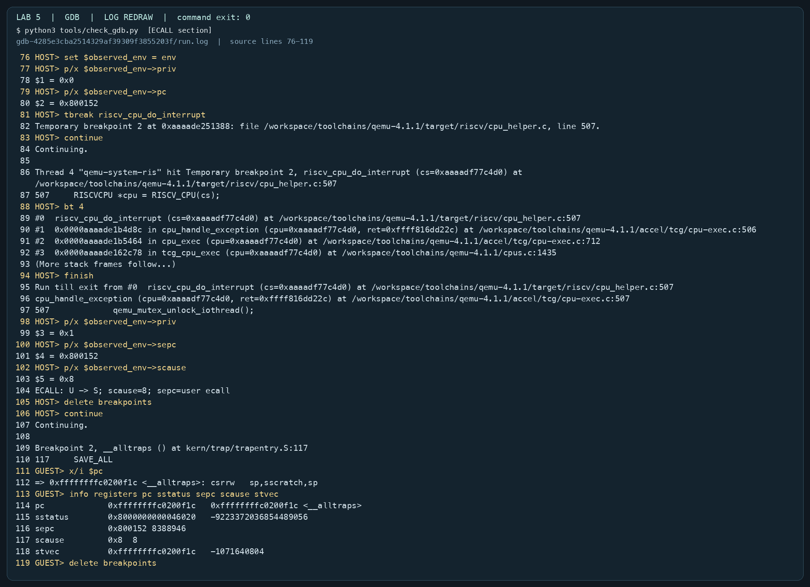
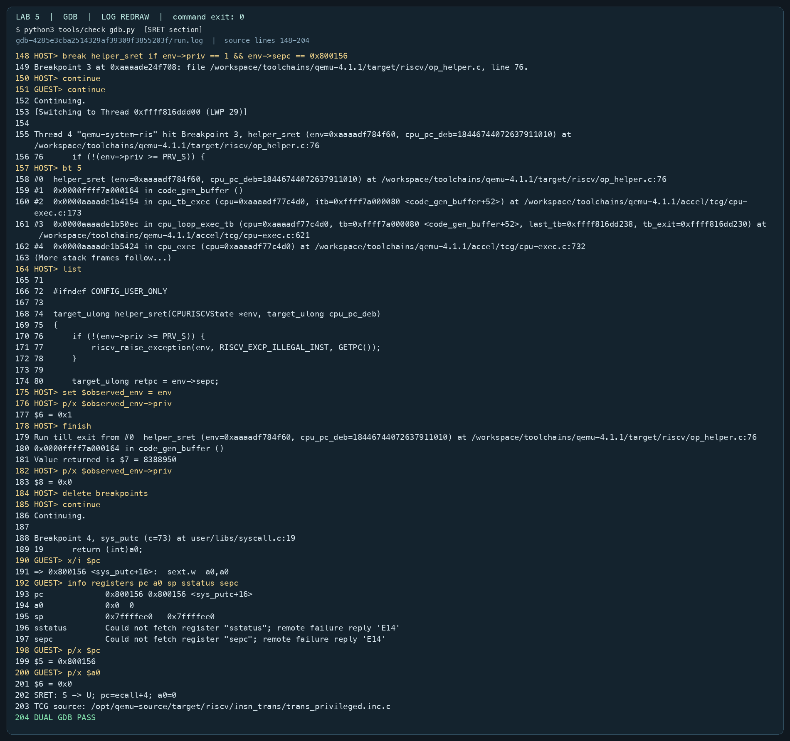

# 操作系统实验报告

## 实验基本信息

| 项目 | 内容 |
|------|------|
| **实验名称** | Lab 5：用户进程管理 |
| **小组成员** | 2413421-黄浩天、2413456-林涛、2413460-彭亚滨 |
| **完成日期** | 2026-11-17 |

### 小组分工

沿用前序实验的模块责任安排：

| 成员 | 负责的练习/模块 | 报告分工 |
|------|----------------|----------|
| 2413421-黄浩天 | 前置内存与 Trap 接口、功能模块一系统调用 | 4.0、4.1，核对内存与用户态入口 |
| 2413456-林涛 | 功能模块二首个用户进程与装载、功能模块三进程复制 | 4.2、4.3，核对创建与资源回滚 |
| 2413460-彭亚滨 | 功能模块四退出与控制、双重 GDB、环境及验证 | 4.4—4.7、第五章、第六章及统稿 |

表格记录小组责任分配。本轮代码实现、命令执行、图像整理和报告由 Codex 辅助完成，未记录成员个人复跑或交叉审核结果。

## 一、实验目的

1. 让用户程序通过 `ecall` 进入内核，在统一分发后通过 `sret` 返回用户态。
2. 建立首个用户进程的 ELF 装载、用户页权限、用户栈和 Trap 返回现场。
3. 完成 `fork/exec/exit/wait/yield/kill` 对应的进程管理逻辑，维护进程树、引用计数和调度状态。
4. 使用 guest GDB 和 host GDB 观察 QEMU 对系统调用异常与特权返回的模拟，区分 TCG 翻译和翻译后代码的运行。

## 二、实验环境

| 成员 | AI 编程工具 | 底层模型 | 备注 |
|------|------------|---------|------|
| 2413421-黄浩天 | ZCode（终端 Agent） | GLM-5.3 | 按前序实验记录沿用的配置 |
| 2413456-林涛 | Codex | GPT-6 | 按前序实验记录沿用的配置 |
| 2413460-彭亚滨 | Codex | GPT-6 | 本轮由 Codex 执行实现与验证 |

| 项目 | 本次实际环境 |
|------|-------------|
| 宿主与容器 | macOS；Docker 中 Ubuntu 22.04 ARM64 |
| 镜像 | `nku-oslab:ubuntu22.04-arm64`，ID `e6d3074984eb2fd3a537055532d013e977a3cf847a5cc76990893235deb38278` |
| 交叉工具链 | riscv64-unknown-elf-gcc 10.2.0；GDB/gdb-multiarch 12.1 |
| 目标与固件 | RV64IMAC、Sv39、单核；QEMU 4.1.1、默认 OpenSBI v0.4、128 MiB RAM |
| 专项调试 | 同版带符号 QEMU；guest GDB 调试 RISC-V，host GDB 附加 ARM64 QEMU 进程 |
| 框架 | 指定 `lab5.zip`，包内 `lab5_new/`，SHA-256 `4dd863d539fc70eb6df24eaab2b45cda7cbf9c7d47817fbee20bda4926b42ae2` |
| 手册 | 2026-11-17 在线镜像 Lab 5，页面内构建时间为 2026-11-10 |
| 前序来源 | 同组 Lab 4 提交 `48d4ca9235b3b1745a938eda6a7cfdfb8611f0ac`，按函数和当前接口适配 |

本次没有智能纪要，实验要求依据指定手册。编译与测试绑定当前仓库目录，每次使用独立临时容器；原评分在容器的临时副本中注入，调试源码只读挂载。操作命令见[仓库 README](../README.md)，教师模板保存在[实验报告模板.md](实验报告模板.md)，完整任务和分析规格见[课程模板提示词](prompt.md)。

## 三、实验整体逻辑分析

### 2.1 本章节的逻辑主线

Lab 4 的线程只在内核态执行。Lab 5 在其上建立两个相互配合的执行路径：一条是 `proc_init → init_main → user_main → kernel_execve → do_execve → load_icode → __trapret → sret`，负责第一次进入用户态；另一条是 `用户库 → ecall → __alltraps → trap → exception_handler → syscall → do_* → __trapret → sret`，负责用户程序运行后的内核服务。

第一次进入用户态时，没有现成的用户态异常现场。内核先构造 Trap 帧，再主动进入通用返回路径；后续系统调用则先由异常入口保存现场，处理完成后恢复原用户栈与返回位置。两种路径共用恢复机制，但现场的来源不同。

### 2.2 功能的逐步实现

前置内存、页表、调度和内核栈接口补齐后，系统才能创建可运行进程。随后把 `sscratch` 和 Trap 恢复扩展为支持 U/S 两类上下文，使用户请求能进入内核并返回。ELF 装载负责创建首个用户地址空间，`fork` 在此基础上复制 VMA、页面和现场，`exit/wait` 再分别承担退出和最终回收。双重 GDB 将这些软件步骤与 QEMU 更新特权级、异常寄存器和 PC 的行为对应起来。

## 四、实验内容与实现

### 4.0 前置继承与双向 Trap 返回

**负责人：** 2413421-黄浩天；调度与线程切换沿用林涛、彭亚滨对应责任。

#### 模块功能描述

保留本次框架的 `SAVE_ALL`、`set_links/remove_links` 和原检查函数，迁入 `page_init`、页映射操作及调度所需功能。`page_init` 从 DTB 读取 RAM，保留内核及 Page 描述数组，按当前 `KERNTOP` 限制管理范围。物理分配器采用本版测试对应的 First-Fit，保留 `default_pmm_manager` 导出名称与 `free_area` 外部可见性；分配拆分空闲块，释放按地址插入并合并相邻块。

```c
static void page_init(void);
void page_remove(pde_t *pgdir, uintptr_t la);
int page_insert(pde_t *pgdir, struct Page *page, uintptr_t la, uint32_t perm);
void proc_run(struct proc_struct *proc);
void schedule(void);
void switch_to(struct context *from, struct context *to);
```

`page_insert` 对同一页的重映射保持净引用计数不变，替换旧页时减少旧引用，更新后刷新 TLB。`get_pte` 在新建下一级页表失败时撤销本轮刚创建的上级目录。`exit_range` 只有在检查整个下级目录为空后才回收它，防止一个 VMA 的退出误释放其他 VMA 仍使用的页表。

`RESTORE_ALL` 根据保存的 `SSTATUS_SPP` 判断返回模式。返回 U 态时，先把展开后的内核栈顶写入 `sscratch`，再恢复 CSR 和通用寄存器，最后恢复用户 `sp`。返回 S 态时保留内核态 `sscratch==0` 的约定。汇编槽位与 `trapframe` 的 36 个寄存器槽一致，地址异常字段采用本版 `tval`。

#### 最终提示词

````markdown
[PROMPT]
**任务**：补齐当前框架 lab2/3/4 标记的物理页管理、页表操作、线程上下文及调度；扩展支持 U/S 双向返回的 RESTORE_ALL。
**操作要求**：kern/mm/default_pmm.c、pmm.c、kern/process/proc.c、switch.S、kern/schedule/sched.c、kern/trap/trapentry.S。保留本版已有 SAVE_ALL、检查函数和断言，按函数迁移同组 Lab4 的必要部分。
**输出要求**：形成对应代码或分析、实际验证结果及报告材料。

[RELY]
Page/free_area/pmm_manager；DTB get_memory_base/get_memory_size；trapframe 含32个GPR及status/epc/tval/cause；sscratch 在用户态保存内核栈顶，在内核态为0。

[GUARANTEE]
page_init、page_insert、page_remove；proc_run、copy_thread、proc_init、schedule、switch_to；RESTORE_ALL 与 __alltraps。

[SPECIFICATION]
**Pre-Condition**：内核使用 RV64/Sv39，启动页表已生效；前序代码来源固定为同组 lab4 提交48d4ca9。
**Post-Condition**：完成物理页发现分配与回收，页映射更新引用计数和TLB；新线程context可恢复；从用户态返回时sscratch保留内核栈顶，恢复原用户sp，内核态返回不污染sscratch。
**Requirements**：同页重映射不增加净引用；分配失败回滚中间页表；用户态和内核态两类Trap都可继续执行。
````


#### 实现迭代过程

##### 第一次迭代

编译先发现前后框架的名称与链接属性差异：误用了旧式地址字段 `badvaddr`，而本版成员为 `tval`；迁入的 `free_area` 声明为 `static`，与当前头文件的 `extern` 冲突。分别按 `trap.h` 和 `default_pmm.h` 修正，没有改动检查函数。前置部分随后通过物理页、页表、VMA 原检查和用户进程启动。

### 4.1 用户态系统调用

**负责人：** 2413421-黄浩天。

#### 模块功能描述

```c
void exception_handler(struct trapframe *tf);
void syscall(void);
static int sys_exit(uint64_t arg[]);
static int sys_fork(uint64_t arg[]);
static int sys_wait(uint64_t arg[]);
static int sys_exec(uint64_t arg[]);
static int sys_yield(uint64_t arg[]);
static int sys_kill(uint64_t arg[]);
static int sys_getpid(uint64_t arg[]);
static int sys_putc(uint64_t arg[]);
static int sys_pgdir(uint64_t arg[]);
```

用户库用 `a0` 传系统调用号，`a1—a5` 传参数。`exception_handler` 识别 `CAUSE_USER_ECALL` 后将 `epc` 增加 4，再调用 `syscall`。分发函数先检查编号边界和表项，成功时调用对应包装函数，无效编号返回 `-E_INVAL`；结果符号扩展后写回 `tf->gpr.a0`。

| 包装函数 | 内核语义 |
|----------|----------|
| `sys_exit/sys_fork/sys_wait/sys_exec` | 转发到 `do_exit/do_fork/do_wait/do_execve` |
| `sys_yield/sys_kill` | 设置调度或退出意图 |
| `sys_getpid` | 返回 `current->pid` |
| `sys_putc` | 调用内核控制台输出单个字符 |
| `sys_pgdir` | 递归打印当前页表中的叶项 |

含用户指针的 `wait/exec` 由对应 `do_*` 接口使用 `user_mem_check` 校验。用户非法访存只终止该用户进程，内核态未预期异常才打印现场并停止。时钟中断重挂下一事件，设置 `need_resched`，在用户 Trap 返回前触发调度。

#### 最终提示词

````markdown
[PROMPT]
**任务**：实现用户 ecall 到内核分发和返回链路。
**操作要求**：kern/trap/trap.c、kern/syscall/syscall.c 与 user/libs/syscall.c；不改变用户可见系统调用号和现有测试。
**输出要求**：形成对应代码或分析、实际验证结果及报告材料。

[RELY]
libs/unistd.h、current->tf；a0为调用号/返回值，a1到a5为参数；CAUSE_USER_ECALL；do_exit/fork/wait/execve/yield/kill及cputchar。

[GUARANTEE]
exception_handler、syscall和sys_exit/sys_fork/sys_wait/sys_exec/sys_yield/sys_kill/sys_getpid/sys_putc/sys_pgdir；用户库按同一RV64 ABI传递参数。

[SPECIFICATION]
**Pre-Condition**：来自用户的ecall已由SAVE_ALL保存完整tf；非法调用号或用户指针可能由不可信程序传入。
**Post-Condition**：ecall的epc增加4；合法请求分发并将int结果写回a0；无效编号返回-E_INVAL；用户指针在访问前按当前mm验证；用户库不向4字节int执行8字节写入。
**Requirements**：用户异常只结束出错进程；内核异常打印现场并panic；不能把用户错误升级为整个内核崩溃。
````


#### 实现迭代过程

原用户封装把 `sd a0` 写入 4 字节 `int ret`，且未在约束中完整表达固定寄存器的使用。新实现使用 XLEN 宽度的寄存器变量，将 `a0` 声明为读写操作数，最后显式转成 `int`；各包装函数给出确定参数和零填充，不再读取未提供的可变参数。

本地原注入测试检查 `getpid`、`epc+4` 和非法调用号；补充用户测试检查编号 0、4096 及非法 `exec` 参数。双重 GDB 进一步记录了实际用户 `SYS_putc` 的寄存器和返回值。

### 4.2 第一个用户进程与 ELF 装载

**负责人：** 2413456-林涛。

#### 模块功能描述

```c
static struct proc_struct *alloc_proc(void);
int kernel_thread(int (*fn)(void *), void *arg, uint32_t clone_flags);
static int init_main(void *arg);
static int user_main(void *arg);
static int kernel_execve(const char *name, unsigned char *binary, size_t size);
int do_execve(const char *name, size_t len, unsigned char *binary, size_t size);
static int load_icode(unsigned char *binary, size_t size);
int do_wait(int pid, int *code_store);
```

`alloc_proc` 清零 PCB，设置未初始化状态、无效 PID、内核页表和链表头。`proc_init` 登记 idle，由其创建 PID 1 的 init；init 再创建 PID 2 的过渡线程 `user_main`。默认选择镜像中的 `exit` 用户 ELF，评分通过 `TEST` 宏选择各个测试程序。

`load_icode` 检查 ELF 标识、ELF64 小端格式、RISC-V 机器类型、程序头大小和范围，再建立独立 `mm` 与根页表。每个可装载段的文件偏移、文件长度、内存长度和用户地址范围均做边界判断。页面先清零，再按段内文件区间拷贝，因此未被文件内容覆盖的 BSS 保持为零；权限依据段的 R/W/X 标志设置，用户叶项包含 `PTE_U`。

用户栈位于 `USTACKTOP` 以下的 1 MiB VMA，最底页保留为未映射保护页，其余页预先分配。入口必须位于可执行 VMA；Trap 帧设置用户栈顶与 ELF 入口，清除 SPP 和 SIE，设置 SPIE。`kernel_execve` 在装载成功后把 `sp` 指向该帧并跳到 `__trapret`，由 `sret` 开始用户执行，不能只把 `do_execve` 当成普通函数调用后返回。

`do_execve` 校验名称和镜像指针；镜像来自用户地址空间时，先保存到内核缓冲区，再解除旧映像。切换到内核根页表后，只有旧 `mm` 最后一个引用消失才回收它。新映像装载失败会清理部分建立的页、页表和 VMA；若原用户映像已被解除，则终止该进程，避免返回已失效地址。

`do_wait` 只等待调用者自己的子进程。存在僵尸时取出退出码并回收其内核栈和 PCB；存在尚未退出的匹配子进程时设置 `PROC_SLEEPING/WT_CHILD` 并调度；没有匹配子进程则返回 `-E_BAD_PROC`。退出码指针在等待前校验为可写。

#### 最终提示词

````markdown
[PROMPT]
**任务**：实现内核线程转为首个用户进程，以及exec和wait。
**操作要求**：kern/process/proc.c；保留本版set_links/remove_links、PID表和Makefile嵌入用户ELF方式。
**输出要求**：形成对应代码或分析、实际验证结果及报告材料。

[RELY]
proc_struct新增exit_code/wait_state/cptr/yptr/optr；mm_map/setup_pgdir/pgdir_alloc_page；elfhdr/proghdr；USTACKTOP/USTACKSIZE；PTE_U/R/W/X；__trapret。

[GUARANTEE]
alloc_proc、kernel_thread、init_main、user_main、kernel_execve、do_execve、load_icode、do_wait。

[SPECIFICATION]
**Pre-Condition**：用户ELF来自镜像中的binary/size，可能截断或畸形；用户exec参数必须先校验再解除旧mm。
**Post-Condition**：新mm含合法ELF段及用户栈，BSS为零；入口与栈可在U态访问；trapframe清SPP、设SPIE；kernel_execve通过__trapret/sret进入U态；wait检查子进程并回收僵尸的PCB和内核栈；全部用户退出后可检查空闲页恢复；在测量前后调用 kmalloc_trim 归还完全空闲的 SLOB 页，保留相等断言。
**Requirements**：内存不足或ELF非法时释放已构建资源；等待中睡眠与退出唤醒一致；保留内核映射，不给用户页表PTE_U权限访问内核。
````


#### 实现迭代过程

首次链接时发现本版没有 `MIN/MAX` 宏，加载段的交集计算和名称截断误用了这两个名称。改为显式的大小比较表达式后链接成功。默认 `exit` 程序实际完成 fork、yield、waitpid 和退出码检查，并输出 `exit pass.`；畸形 ELF 清理由独立自测覆盖。

### 4.3 用户进程复制

**负责人：** 2413456-林涛。

#### 模块功能描述

```c
int do_fork(uint32_t clone_flags, uintptr_t stack, struct trapframe *tf);
static int copy_mm(uint32_t clone_flags, struct proc_struct *proc);
int dup_mmap(struct mm_struct *to, struct mm_struct *from);
int copy_range(pde_t *to, pde_t *from, uintptr_t start, uintptr_t end, bool share);
```

`do_fork` 依次分配 PCB、内核栈和地址空间，再建立子 Trap 帧与 context。子帧中的 `a0=0`，用户栈指针继承父帧；父调用返回新 PID。PID、哈希表、进程链表和父子兄弟关系在关中断的临界区内发布，然后唤醒子进程；前面任一步失败都沿反向路径回收资源。

`copy_mm` 对内核线程保留 `mm==NULL`；`CLONE_VM` 共享同一个 `mm` 并增加计数；普通 fork 创建新 `mm`，加锁读取父地址空间，通过 `dup_mmap` 复制 VMA，通过 `copy_range` 分配并拷贝实际页面。页权限随原映射保留，父子普通可写页使用不同物理页。只读文本依然为只读，本次没有 COW 页共享。

`mm_map` 对整个既有 VMA 列表检查区间相交，拒绝覆盖已有区间的映射，并在地址相加前检查溢出。这样在进程复制或装载失败时可返回错误，由调用者清理，避免让重叠区域进入原来的断言路径。

#### 最终提示词

````markdown
[PROMPT]
**任务**：实现fork的地址空间复制和子进程上下文。
**操作要求**：kern/process/proc.c、kern/mm/vmm.c、kern/mm/pmm.c；普通fork采用立即复制，COW选做本次不启用。
**输出要求**：形成对应代码或分析、实际验证结果及报告材料。

[RELY]
copy_thread/get_pid/setup_kstack/set_links/hash_proc/wakeup_proc；mm_create/lock_mm/mm_count；VMA区间和PTE权限；CLONE_VM。

[GUARANTEE]
do_fork、copy_mm、dup_mmap、copy_range。

[SPECIFICATION]
**Pre-Condition**：父进程mm有效，或内核线程mm为NULL；输入VMA按地址顺序且不重叠。
**Post-Condition**：父返回子PID、子返回0；子PCB、内核栈、用户物理页独立；VMA范围/权限/数据保持；CLONE_VM增加共享mm计数；失败时不发布半成品进程，释放所有已分配资源。
**Requirements**：不可写文本仍保留只读/执行权限；共享mm只在最后一个持有者退出时销毁；fork产生的子进程挂入正确的兄弟与父子链。
````


#### 实现迭代过程

本轮普通 fork 和子进程独立执行在原评分中通过。额外检查让子进程修改全局变量并以 42 退出，父进程仍读到原值 7，且取得退出码 42；还核对了 `CLONE_VM` 的计数从 1 增至 2 并正确减少。页表 OOM 检查只留下一个空闲物理页，确认无法分配完整两级目录时不遗留上级目录或丢失空闲页。

### 4.4 进程退出与控制

**负责人：** 2413460-彭亚滨。

#### 模块功能描述

```c
int do_exit(int error_code);
int do_yield(void);
int do_kill(int pid);
void kmalloc_trim(void);
```

`do_exit` 禁止 idle/init 退出，先切回内核页表，再减少当前 `mm` 引用；最后一个使用者负责销毁用户映射、页表和 `mm`。进程记录退出码并成为僵尸，唤醒正在等待的父进程，把仍存在的子进程转交 init，然后进入调度。自身的内核栈和 PCB 此时仍在使用，由父进程的 `do_wait` 最终释放。

`do_yield` 设置 `need_resched`；`do_kill` 检查目标并设置 `PF_EXITING`，若目标处于可中断等待则唤醒。实际退出在用户 Trap 返回或等待恢复后的检查点执行。睡眠、唤醒、进程树和状态标志更新使用当前框架的中断临界区约定。

#### 最终提示词

````markdown
[PROMPT]
**任务**：实现exit、yield、kill与wait配合形成资源回收闭环。
**操作要求**：kern/process/proc.c，沿用本版调度和等待标志；不删除断言或评分检查。
**输出要求**：形成对应代码或分析、实际验证结果及报告材料。

[RELY]
PF_EXITING/WT_CHILD/WT_INTERRUPTED；PROC_SLEEPING/RUNNABLE/ZOMBIE；initproc/idleproc；mm_count/exit_mmap/put_pgdir/mm_destroy。

[GUARANTEE]
do_exit、do_yield、do_kill，配合do_wait；kmalloc_trim仅释放完整空闲页，kmalloc按向上取整页数选择阶数。

[SPECIFICATION]
**Pre-Condition**：当前进程可能拥有或共享mm；目标PID可能不存在、已被kill，或处于可中断等待。
**Post-Condition**：退出先切回内核页表再销毁最后引用的mm，记录退出码并成为僵尸，唤醒等待父进程，子进程转交init；yield置need_resched；kill置PF_EXITING并唤醒可中断等待。
**Requirements**：禁止idle/init退出；重复kill按本框架错误码处理；不能在仍使用自身栈时释放它；退出进程不再返回调用点。
````


#### 实现迭代过程

第一轮原评分为 123/130，`forktest` 已打印通过，但 init 的空闲页相等断言失败。定位到 SLOB 在大量 PCB/VMA 分配后保留了完整空闲页，没有归还物理分配器。新增 `kmalloc_trim` 从空闲链中摘出整页对齐、完整未使用的页，分别在用户进程测试前后调用，保留 `nr_free_pages()==free_store` 检查。

同时检查到大块分配的阶数计算向下截断：申请 8193 字节可能只分配 8192 字节。改为按页数向上取整后求最小二次幂，补充 `ksize>=8193` 和实际写入检查。修正后原评分为 130/130，额外测试中的孤儿子进程也由 init 回收，最终剩余 idle/init 两个进程。

### 4.5 系统调用双重 GDB 调试

**负责人：** 2413460-彭亚滨。

guest GDB 加载 `bin/kernel` 和 `obj/__user_exit.out`，在用户 `sys_putc` 的 `ecall` 前设置硬件断点。host GDB 附加同一 QEMU 进程，在 `helper_raise_exception`、`riscv_cpu_do_interrupt` 和 `helper_sret` 处跟踪实际状态；QEMU 原源码保持不变。

本次记录的用户 `ecall` 位于 `0x800152`，调用号 `a0=30`，参数 `a1=0x49`，即字符 `I`。进入异常处理前 host 读到 `priv=0`；`riscv_cpu_do_interrupt` 返回后为 `priv=1`、`scause=8`、`sepc=0x800152`，PC 指向 S 态异常入口。内核处理完成后，guest 在 `__trapret` 的 `sret` 前停止，`sepc=0x800156`、SPP 为 0，`sscratch` 保存内核栈顶。

host 在 `helper_sret` 中读到返回前 `priv=1`，函数结束后为 0；guest 随后在 `0x800156` 的返回地址断下，`a0=0`，表明该字符输出请求已返回。这里记录的是同一个调用点；不同字符会重复使用它，调试脚本用断点时序区分具体一次执行。

#### 最终提示词

````markdown
[PROMPT]
**任务**：完成当前手册指定的guest/host双GDB观察，分别跟踪ecall和sret。
**操作要求**：新增tools/check_gdb.py和复现入口；只读使用QEMU4.1.1源码和带符号可执行文件，不修改第三方源码。
**输出要求**：形成对应代码或分析、实际验证结果及报告材料。

[RELY]
guest GDB加载bin/kernel及obj/__user_exit.out；host GDB可SYS_PTRACE附加专属QEMU PID；QEMU的helper_raise_exception、riscv_cpu_do_interrupt、helper_sret和TCG翻译路径。

[GUARANTEE]
可重复执行的调试脚本；ecall/sret前后PC、特权级及sepc/sstatus/stvec等状态；实际源码调用栈和日志。

[SPECIFICATION]
**Pre-Condition**：用户exit程序构建成功，专用QEMU以-S和gdb端口启动；两个GDB都连接在同一容器内。
**Post-Condition**：实际在用户ecall前停止；host观察U态ecall异常与S态入口；在__trapret的sret前停止并观察返回U态；记录指令与断点证据，结束后只清理本次子进程。
**Requirements**：区分TCG翻译期断点与helper运行期断点；加载用户符号避免只命中内核syscall；断点受TB缓存影响时如实记录。
````


#### 实现迭代过程

初次双重调试在 host 中已看到 `helper_sret` 将特权级改成 U，但 guest 的单步没有稳定停在预期的用户返回点，而是运行到后续切换位置。改为在 `ecall+4` 设置硬件断点，再运行 `sret`，同时由 host 检查 helper 的前后状态。复跑又发现暂停期间到期的时钟中断会先进入同一异常入口，因此给入口断点增加 `scause==8` 与目标 `sepc` 条件，以硬件断点限定异常入口和用户返回位置。修改的是调试同步方法，未改动内核指令或 QEMU 源码。

### 4.6 TCG 与地址翻译调试的联系

TCG 将 RISC-V 指令翻译成宿主 ARM64 可执行的代码，并缓存为 Translation Block。源码 `target/riscv/insn_trans/trans_privileged.inc.c` 中，`trans_ecall` 生成异常处理调用，`trans_sret` 生成 `helper_sret` 调用并结束当前块；运行这些代码时，`op_helper.c` 和 `cpu_helper.c` 更新异常、CSR、特权级与下一条 PC。实际 host 回溯中可见 `code_gen_buffer → cpu_tb_exec → cpu_loop_exec_tb` 以及对应 helper。

本次断点实测覆盖运行期 helper 和异常分发；翻译期函数根据同一份 QEMU 4.1.1 源码阅读说明，没有把静态阅读写成翻译断点命中记录。TCG 翻译不是虚拟地址到物理地址的页表翻译。Lab 2 的双重调试同样在执行 TCG 生成的访存代码时进入 TLB/MMU 路径，两者处于同一个模拟执行过程中的不同环节。

### 4.7 调试现象与问题定位

guest 只有内核符号时不能按用户源文件定位，加载用户 ELF 后才能在用户库中断下。QEMU 4.1.1 的远程寄存器接口在 U 态读取部分 supervisor CSR 时返回 `E14`；因此以 S 态的 CSR 读数和 host 直接观察的 `CPURISCVState` 为准；返回 U 态后的 `E14` 不作为 CSR 为零或特权返回失败的依据。

普通启动完成后进入监视器，无输入时 `readline` 返回空会重复输出提示符。自动启动检查据真实的 `init check memory pass.` 结束条件终止专属 QEMU 进程组，避免把持续输出误判为用户程序未退出。原评分仍通过原来的 GDB 断点结束测试；未删减其检查过程。

### 练习：用户镜像的预加载与运行时装载

用户程序先由交叉工具链生成 ELF；Makefile 链接内核时，用 `--format=binary $(USER_BINS)` 将这些 ELF 字节嵌入内核镜像，并产生 `_binary_obj___user_*_out_start/_size` 符号。QEMU loader 将整个镜像加载到物理地址 `0x80200000`，因此用户 ELF 字节在进入 `user_main` 之前已经随内核存在于 RAM 中。

这些预置字节还不是进程可直接执行的用户映像。运行时 `load_icode` 仍要解析 ELF、分配用户物理页、拷贝各段、建立权限与用户栈，再从入口开始执行。常见操作系统通常通过文件系统按路径读取可执行文件，并可按需装页；本实验用嵌入镜像的方式简化存储来源，尚未实现文件系统和磁盘加载。

### Challenge：COW（选做范围）

手册将 COW 和相关漏洞模拟列为扩展练习。本次完成必做模块与指定双重 GDB 专项，没有实现或测试 COW，也未模拟 Dirty COW。普通 fork 使用立即分配并复制页面，不能据此声称具有 COW 性能或安全性质。

## 五、测试与验证

### 5.1 构建与当前框架本地评分

通过 `tools/run-in-docker.sh` 在当前仓库执行 `make clean && make -j2`，退出码为 0。编译期间 `testbss.c` 的越界警告来自原测试故意实施的越界写入，保留该测试及诊断。


图 1：本次真实 build 日志连续末段重绘，退出码 0。图内标明日志文件及原始行范围。

原 `make grade` 在临时副本运行 `inject.py`，分别向 `proc_init` 尾部和 `init_main` 入口插入原 Process Create、Syscall、Process Control 检查，然后执行 13 个用户程序。每例功能输出 7 分、通用检查 3 分，总计 **130/130**，命令退出码 0；这是本地当前框架评分，不是远端评分结果。当前镜像中原脚本的逐例计时字段显示为 `(s)`，本报告不据此提供逐例耗时。

| 用例 | 结果 | 用例 | 结果 |
|------|------|------|------|
| badsegment | 10/10 | divzero | 10/10 |
| softint | 10/10 | faultread | 10/10 |
| faultreadkernel | 10/10 | hello | 10/10 |
| testbss | 10/10 | pgdir | 10/10 |
| yield | 10/10 | badarg | 10/10 |
| exit | 10/10 | spin | 10/10 |
| forktest | 10/10 | 合计 | 130/130 |


图 2：本次 grade 原日志连续评分段重绘，命令 `make grade`，退出码 0。原评分、注入、测试源和原用户测试的 SHA-256 均与输入框架一致；内嵌检查函数也逐函数核对为原文。

### 5.2 普通启动


图 3：本次 `check_boot.py` 调用实际 `make qemu` 的连续日志重绘。用户 `exit` 完成父子进程创建、等待和退出，输出 `exit pass.`、`all user-mode processes have quit.`、`init check memory pass.`。检查器退出码为 0；在观察到结束标志后向自己创建的 QEMU 进程组发送 SIGTERM，子进程状态为 -15，不把它写成 QEMU 自行正常退出。

### 5.3 补充边界检查


图 4：本次独立补充自测日志连续段重绘，检查器退出码 0。七组分别检查 8193 字节分配边界、页表 OOM 回滚、VMA 重叠/溢出与共享计数、畸形 ELF 清理、fork 隔离及退出码、只读文本写入异常、孤儿回收及无效系统调用/exec。最后仍经过 init 的物理空闲页相等检查。该自测在临时副本添加检查和用户程序，不改变原评分文件，不计入 130 分。

### 5.4 双重 GDB



图 5：本次双 GDB 日志中异常发生前后连续片段重绘，包含 host 的 `priv/sepc/scause` 与 guest 的入口状态。



图 6：同次双 GDB 日志中 `helper_sret` 前后与用户返回位置的连续片段重绘，包含 `priv:1→0`、返回 PC 和 `a0=0`。专项脚本退出码为 0；所有调试器和专属 QEMU 已清理。

图片均直接读取本次保留的真实日志重绘，未改写展示片段的内容；原日志、命令、退出码、行范围、SHA-256 和重绘脚本留在本地树外验证目录。

## 六、实验总结与收获

### 对操作系统的理解

| 本实验内容 | 对应 OS 原理 | 实现范围与区别 |
|------------|-------------|----------------|
| ecall、分发、sret | 受控特权级切换与系统调用 ABI | 用户通过寄存器约定请求内核；S 态处理与用户返回分离 |
| VMA 与页表 | 地址空间描述与硬件访问控制 | VMA 用于合法区间检查，PTE 决定实际映射与权限 |
| fork 与 CLONE_VM | 进程复制与地址空间共享 | 普通 fork 复制物理页；共享路径维护 mm 引用，不等同于 COW |
| exit 与 wait | 僵尸状态、父子同步及延迟回收 | 当前进程释放用户映像，父进程回收仍使用过的内核栈/PCB |
| TCG 与 helper | 模拟器动态二进制翻译 | 指令语义被宿主代码执行；与访存时的 MMU 地址翻译不同 |

#### 尚未覆盖的原理

本实验没有文件系统装载、按需分页、交换、COW、多核同步、现代调度策略或完整信号机制。当前 `kill` 使用退出标志和可中断等待配合，并非通用信号子系统；调度面向单核和简单进程链表。评分通过只覆盖所列环境、原用例及补充边界，不推广为完整操作系统兼容性结论。

### AI 协作开发的经验

#### AI 协作与规格修订

四段式规格把任务、已有接口、输出接口与前后条件分开。迁入旧代码前须逐项对照当前结构和头文件，本轮的 `tval`、`free_area` 和未定义宏错误都说明仅按函数名迁入不够。系统调用规格同时约束用户封装与内核 Trap 帧，才覆盖了 RV64 返回值宽度问题。

评分失败后，保留原输出，沿 `forktest → init 回收检查 → SLOB 缓存` 定位；规格随后加入测试前后归还完整空闲页的要求，并保留相等断言。双 GDB 的改动则针对两个调试器的停止时序，用用户返回地址断点与 host 的特权级状态共同判断结果。两类问题分别需要资源守恒和控制流证据，不能只以终端出现 PASS 判断全部正确。
